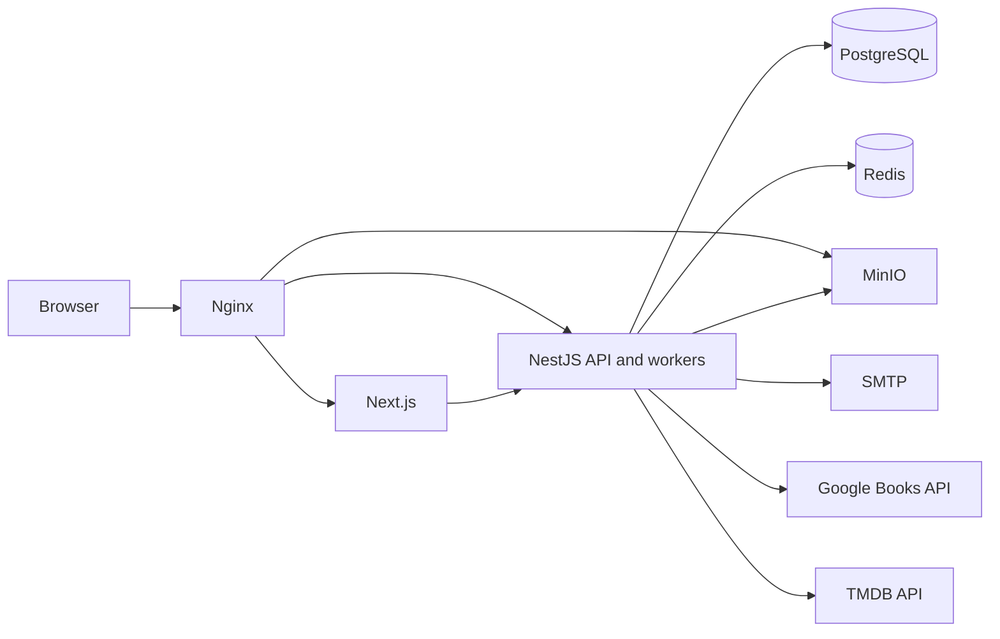
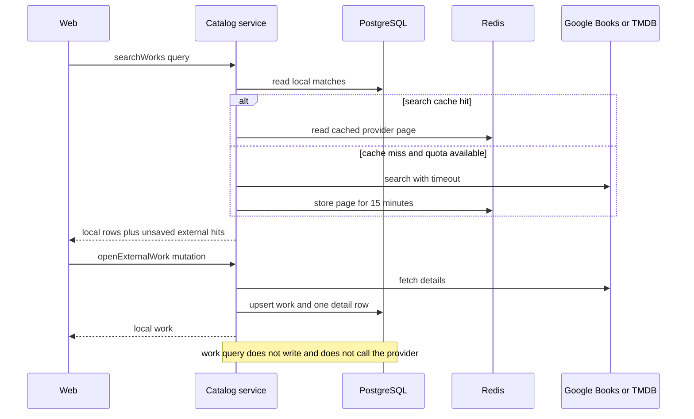

# CULTURE SPACE — Architecture

**Status:** APPROVED  
**Version:** 0.4  
**Approved:** 2026-11-02 by the product owner, as proposed  
**Scope:** Technical foundation. Milestone 1 starts only on a separate explicit instruction.

This document is the approved architecture for CULTURE SPACE. Product requirements live in `PROJECT_SPEC.md`. The implementation sequence lives in `DEVELOPMENT_PLAN.md`. The relational design lives in `DATABASE.md`. The API contract lives in `GRAPHQL_API.md`.

Decisions D-01 through D-68 are approved. Q-22 option A and Q-24 option A are confirmed. Episode-by-episode tracking, Socket.IO, and account deletion stay out of the MVP. Q-21 stays open until the Milestone 3 genre gate. Anything marked **Confirmed** is required by `PROJECT_SPEC.md` or by that approval.

---

## 1. Purpose

CULTURE SPACE is an international social platform for books, movies, and TV series. The system must let people keep a personal cultural library, publish reviews, hold threaded discussions, run clubs, and follow other people — while remaining usable as a private tracker.

The initial release is a responsive web application. Native mobile applications, machine learning, direct messages, and episode-by-episode tracking are outside the MVP. The architecture must leave room for them without introducing microservices or unused infrastructure.

---

## 2. Confirmed requirements

The following constraints come directly from the specification and are not open for silent change:

| Area | Confirmed choice |
| --- | --- |
| Architecture style | Modular monolith |
| Backend | NestJS, TypeScript strict, GraphQL Code First, Apollo Server |
| ORM | TypeORM only. Prisma is forbidden |
| Database | PostgreSQL. UUID primary keys. Explicit foreign keys, unique constraints, and indexes. `synchronize` disabled in production |
| API style | GraphQL for business operations. Queries read. Mutations write. Subscriptions only for real-time delivery |
| Sessions | Redis server-side sessions. HttpOnly cookies. JWT is not the primary authentication mechanism |
| Passwords | Argon2 |
| Authorization | Role-based access control: `USER`, `MODERATOR`, `ADMIN`. Ownership checks on the server. Client-supplied user ids are never trusted |
| Catalog | Shared `Work` plus type-specific details for `BOOK`, `MOVIE`, `TV_SERIES` |
| External data | Google Books API and TMDB API. Calls isolated in integration modules. Already synchronized works render without those APIs. User-generated content is never stored at the provider |
| Queue | BullMQ on Redis, only where asynchronous work is justified |
| Files | MinIO for application-managed uploads. Remote poster and cover URLs stay remote |
| Frontend | Next.js, React, TypeScript, Apollo Client, Tailwind CSS, React Hook Form, Zod |
| Locales | English and Russian UI. User-generated content may be in any language. Original titles are preserved |
| Clients | Responsive web: desktop, tablet, mobile browser |
| Package manager | pnpm, as required by the CI pipeline |
| Delivery | Docker, Docker Compose, Nginx, GitHub Actions, GitHub Container Registry, Linux VPS |
| Tests | Jest: unit, integration, and end-to-end GraphQL journeys |
| Search | PostgreSQL full-text search unless a later measurement proves it insufficient. Elasticsearch is out of the MVP |

---

## 3. System context



The browser talks to one public origin. Nginx routes page traffic to Next.js, GraphQL and WebSocket traffic to NestJS, and presigned media traffic to MinIO. PostgreSQL, Redis, and the MinIO console are not published on the host.

External catalog providers are called only by the API. The browser never receives provider credentials.

---

## 4. Modular monolith

### 4.1. Recommendation D-01 — repository shape

**Proposal.** One pnpm workspace with two applications:

```text
apps/api          NestJS modular monolith
apps/web          Next.js application
docker/           Dockerfiles and Nginx configuration
.github/workflows CI and CD
```

Shared TypeScript types for the frontend are generated from the GraphQL schema into `apps/web`. There is no shared runtime package of entities or services. The schema is the contract.

**Why this fits.** The specification already requires pnpm, one backend, and one frontend. A workspace keeps CI, Docker, and local composition in one repository without pretending the applications are one process.

**Alternatives.**

| Alternative | Advantages | Disadvantages |
| --- | --- | --- |
| Two Git repositories | Independent release cadence | Contract drift, duplicated CI, harder MVP delivery |
| Single application mixing Next.js route handlers and domain logic | Fewer packages | Breaks the required NestJS boundary and invites business logic in the UI |
| npm or yarn workspaces | Familiar tooling | Conflicts with the required pnpm CI steps |

**Risks.** Workspace tooling must be learned once. Generated GraphQL types can become stale if codegen is not part of CI. Mitigation: CI fails when generated types do not match the schema.

### 4.2. Backend module boundaries

**Recommendation D-51.** NestJS modules follow domain ownership. Books, movies, and series are folders and resolvers inside one `CatalogModule`, because they share the `Work` aggregate. They are not separate deployable services.

```text
apps/api/src/
  common/            guards, errors, pagination, dataloader context, ports
  config/            validated environment
  database/          data source, migrations, seeds
  infrastructure/    redis, queue, storage, mail, realtime, logger
  integrations/      google-books, tmdb
  modules/
    auth/
    users/
    catalog/
    library/
    reviews/
    discussions/
    comments/
    reactions/
    clubs/
    activity/
    notifications/
    search/
    recommendations/
    analytics/
    moderation/
  app.module.ts
  main.ts
```

`users` owns profiles, preferences, favorites, and follows. `reviews` owns reviews and the rating aggregate. `comments` and `reactions` are shared kernels used by discussions, reviews, and clubs. `activity` and `notifications` are the only cross-cutting write sides.

### 4.3. Dependency direction

An arrow means “depends on”. Cycles are forbidden.

```text
auth -> users, mail, queue, redis
catalog -> google-books, tmdb, queue
reviews -> catalog, activity
library -> catalog, reviews, activity
discussions -> catalog, comments, activity, notifications
clubs -> catalog, comments, users, activity, notifications
reactions -> entity repositories of reactable targets
comments -> none of the product modules
search -> catalog, users, discussions, clubs
recommendations -> catalog, library, users
analytics -> library, reviews, discussions, users
moderation -> content repositories, users
notifications -> users, queue
activity -> users
```

Rules:

1. Business rules live in services. Resolvers authenticate, validate, and delegate.
2. A module may call another module only along the arrows above.
3. A module may register a field resolver on another module's GraphQL type.
4. Cross-module transactions receive TypeORM `EntityManager` explicitly. They do not open a second hidden transaction.
5. Integration clients perform HTTP only. They do not import domain services.
6. There is no generic in-process event bus in the MVP. Activity is recorded by a direct call inside the transaction. Mail, session invalidation, and notifications are rows in `outbox_messages` in that same transaction (decision D-62).

**Why not an event bus.** The MVP needs atomic activity records and simple reasoning about failures. A bus hides ordering and makes transactional guarantees unclear. One outbox table plus BullMQ is enough.

**Alternative.** Nest `EventEmitter` after commit. Advantage: looser coupling. Disadvantage: lost events on crash, awkward transactions, harder tests. Rejected for MVP writes that must be consistent.

**Risk.** `reactions` touching several entity repositories can become a grab bag. Mitigation: the service only inserts a reaction row and adjusts denormalized counters. It does not apply foreign domain rules.

### 4.4. Request lifecycle

```text
Nginx
  -> Apollo Server
    -> depth and complexity limit
    -> rate limit
    -> session middleware loads the Redis session
    -> guard resolves the current user from the database
    -> ValidationPipe on the input DTO
    -> resolver
      -> service transaction
        -> PostgreSQL domain rows
        -> activity row when required
        -> outbox row when mail, session invalidation, or a notification is required
      -> poller reads the outbox after commit
      -> BullMQ worker sends mail, deletes sessions, or inserts the notification
```

GraphQL field resolvers that need related rows use request-scoped DataLoaders created in the GraphQL context. They do not call repositories in a loop.

---

## 5. Backend design

### 5.1. Runtime baseline

**Recommendation D-02.** Pin the following at implementation time, then record the exact patch versions in the lockfile:

- Node.js 24 LTS
- PostgreSQL 17
- Redis 7
- NestJS current stable that supports the chosen Node release
- TypeORM current stable 0.3 line

**Why.** These are the current long-term-support building blocks for a new project and they match the required stack. Versions stay pinned. They are not floated in production.

**Alternative.** Node.js 22 LTS if a required library does not yet support Node 24. That choice can be made at Milestone 1 without changing the architecture.

**Risk.** A too-new Node release can lag behind native dependencies. Mitigation: the Milestone 1 spike verifies NestJS, TypeORM, Argon2, and the Redis session store on the chosen image before feature work starts.

### 5.2. Configuration

**Recommendation D-35.** `@nestjs/config` loads environment variables. Zod validates them at process start. The process refuses to boot when a required variable is missing.

GraphQL input validation uses `class-validator` and Nest `ValidationPipe`, because that is the Code First integration path. Zod remains the validator for environment variables and for untrusted Google Books and TMDB payloads.

**Alternative.** Zod for GraphQL inputs through a custom pipe. Advantage: one validation library. Disadvantage: more custom infrastructure before the first feature. The split is intentional and limited to two places.

**Risk.** Two validation styles can drift. Mitigation: GraphQL DTOs never parse external HTTP payloads, and integration schemas never parse client input.

### 5.3. Error contract

Domain services throw typed errors:

| Code | Meaning |
| --- | --- |
| `UNAUTHENTICATED` | No valid session |
| `FORBIDDEN` | Authenticated, not allowed |
| `EMAIL_NOT_VERIFIED` | Session exists, write is blocked |
| `NOT_FOUND` | Hidden as not found when revealing existence would leak private data |
| `CONFLICT` | Unique constraint or illegal state transition |
| `VALIDATION` | Field-level business validation |
| `RATE_LIMITED` | Abuse control |
| `EXTERNAL_UNAVAILABLE` | Provider failed and no local data can satisfy the request |

The GraphQL formatter exposes `extensions.code` and `extensions.i18nKey`. It does not expose SQL, provider payloads, or stack traces. The frontend translates `i18nKey`.

Private clubs, private libraries, and removed content return `NOT_FOUND` when the viewer must not learn that the record exists. `FORBIDDEN` is reserved for cases where the viewer already knows the resource, such as an active member losing a permission.

### 5.4. Logging

**Recommendation D-65.** Pino is the API logger. Redaction covers passwords, tokens, cookies, authorization headers, and raw provider payloads. Request logs include a correlation id. This decision is separate from D-36, which covers the frontend stack.

**Alternative.** The Nest default logger. Advantage: no extra dependency. Disadvantage: weak structure and weak redaction for a production social platform.

### 5.5. The only non-GraphQL routes

**Recommendation D-37.** Business operations are GraphQL. Two infrastructure routes exist because orchestrators cannot express health as a user workflow:

- `GET /health` — process is up
- `GET /ready` — PostgreSQL and Redis respond

File upload is not a REST business endpoint. The client asks GraphQL for a presigned URL and uploads bytes directly to MinIO.

---

## 6. Authentication and sessions

### 6.1. Recommendation D-19 — session model

**Proposal.**

- `express-session` with Redis store via `connect-redis`.
- Passport local strategy validates email and password. The login mutation then calls `req.session.regenerate` and stores the session.
- The session payload contains `userId` and `issuedAt` only.
- Every authenticated request loads the user row by that id. Role, account status, and verification are never trusted from the cookie or from stale session JSON.
- Cookie name: `cs.sid`.
- Flags: `HttpOnly`, `SameSite=Lax`, `Path=/`, `Secure` in production.
- Idle lifetime: 14 days, implemented as the session TTL, refreshed on use.
- Absolute lifetime: 30 days, enforced with `issuedAt`. When it passes, the session is destroyed even if it is still in use.
- Concurrent sessions are allowed.
- Redis key `user-sessions:{userId}` is a set of session ids so password change, reset, and “log out everywhere” can delete them.

**Why this fits.** The specification requires server-side Redis sessions and forbids JWT as the primary mechanism. Storing only the user id means demotion, suspension, and email verification take effect on the next request.

**Alternatives.**

| Alternative | Advantages | Disadvantages |
| --- | --- | --- |
| JWT in an HttpOnly cookie | Stateless API | Fails the specification. Revocation needs a denylist that recreates server-side sessions |
| Full user profile inside the session | Fewer database reads | Stale roles and stale bans |
| One session per user | Simple invalidation | Poor experience across phone and desktop |

**Risks.** A database read per request is extra load. Mitigation: the user row is small and indexed by primary key; a later short-lived cache may be added only if measurement requires it. Session fixation is handled by regeneration at login. Session theft through XSS is mitigated by `HttpOnly` and by never putting the session id in GraphQL responses.

### 6.2. Recommendation D-20 — CSRF

The web application and GraphQL endpoint share one origin, so the session cookie is host-only.

Defense in depth:

1. `SameSite=Lax`.
2. Mutations reject requests whose `Origin` or `Referer` is not the configured application origin.
3. Mutations require the header `x-culturespace-client: web`, which a classic cross-site form post does not set.

**Alternative.** Synchronizer CSRF token in a second cookie. Advantage: textbook double-submit. Disadvantage: more client machinery for a same-origin deployment that already has the controls above. It can be added later without a domain change.

**Risk.** A misconfigured second origin in production would break the assumption. Mitigation: production compose publishes only Nginx, and the application origin is a required environment variable.

### 6.3. Password policy

**Recommendation D-22.** Passwords are 10 to 128 characters. Composition rules are not required. The hash is Argon2id with OWASP-oriented parameters (`memoryCost` 19456, `timeCost` 2, `parallelism` 1), revisited when the Milestone 1 spike measures login latency.

Reset and change flows store only a SHA-256 hash of the single-use token. Verification tokens expire after 24 hours. Reset tokens expire after 1 hour. Consuming a reset token deletes every session of that user.

**Confirmed addition under the same decision.** `changePassword` is part of account settings even though the specification only spells out email recovery. A logged-in user must be able to rotate a password and keep the current session.

### 6.4. Registration and verification

Registration creates the user, the preference row, a verification token, and a `SEND_EMAIL` outbox row in one transaction. The poller sends the mail after commit. The new session is established immediately so the user can stay on the verification screen.

**Recommendation D-21 — unverified access.**

| Allowed before verification | Blocked until verification |
| --- | --- |
| Read public catalog, public profiles, public discussions, public clubs | Follow and unfollow |
| `me`, update own profile, preferences, and avatar | Library writes |
| Resend verification, verify, logout, password flows | Reviews, ratings, discussions, comments, reactions |
| | Clubs, reports, and any other write |

Public reads stay available so a delayed email does not make the product look broken.

**Alternative.** Refuse login until the email is verified. Advantage: smaller attack surface. Disadvantage: worse recovery when the message is slow, and it fights the required “restricted access” wording, which implies the account exists in a limited state.

### 6.5. Brute force and enumeration

Redis counters:

- Login: 5 failures per email per 15 minutes, and 20 failures per IP per 15 minutes.
- Registration: 5 per IP per hour.
- Password reset request: 3 per email per hour.
- Global GraphQL rate limit through a Redis-backed throttler.

Login and password reset responses do not reveal whether the email exists. Registration may report a duplicate email or username because the person is trying to create those identifiers.

### 6.6. Roles

**Recommendation D-50.** A user has one platform role. `ADMIN` includes moderator powers. Club roles are unrelated and live on `club_memberships`.

Only an administrator can change platform roles. A moderator cannot moderate an administrator account. Suspension and posting restrictions are auditable rows, not boolean flags scattered across the user table.

---

## 7. Privacy and authorization

**Recommendation D-17.**

| Surface | Public profile | Private profile |
| --- | --- | --- |
| Username, full name, avatar, biography | Visible | Visible |
| Email and authentication data | Never | Never |
| Library | Visible only when `library_visibility = PUBLIC` | Hidden |
| Statistics and activity | Visible | Hidden |
| Followers and following counts | Visible | Visible |
| Public reviews and discussions | Still readable at their own URLs | Still readable at their own URLs, omitted from the profile aggregation |

`library_visibility` is independent. The default is `PUBLIC`. When `profile_visibility` is changed to `PRIVATE`, library visibility is set to `PRIVATE` as well. The owner may later make the profile public again while keeping the library private.

Review visibility is `PUBLIC` or `PRIVATE`. A private review is visible only to its author and to moderators. Discussion visibility in the MVP is public. Club posts inherit the club boundary.

**Private clubs.** Non-members receive `NOT_FOUND` for posts, activities, member lists, and the club document itself in member contexts. **Recommendation D-30:** private clubs are excluded from public search and discovery. Access arrives through an invitation or an existing membership.

**Recommendation D-55.** Follow is immediate. Private profiles do not require approval in the MVP. The specification places follow approval in a future version. Following a private profile does not reveal the hidden sections.

**Spoiler content.** `containsSpoilers` is a presentation flag. The API still returns the text. **Recommendation D-44:** the client masks it until the reader chooses to reveal it. A user preference `showSpoilers` disables the mask. This is not an authorization boundary.

**Risk.** A bug in one resolver can leak a private club post through a nested field. Mitigation: authorization helpers are applied in services that load the record, not only at the root resolver. Tests in every social milestone cover anonymous, non-member, member, and moderator viewers.

---

## 8. Catalog and external synchronization

### 8.1. Work aggregate

**Recommendation D-04 and D-05.** `works` stores fields shared by every cultural work. `book_details`, `movie_details`, and `tv_series_details` use `work_id` as their primary key, so the one-to-one relationship is enforced by the database. Localized titles and localized descriptions live in `work_localizations`.

The canonical primary date used for catalog filters is `works.release_date` (publication date, theatrical date, or first air date). Series still store `first_air_date` and `last_air_date`. The sync service writes `release_date` and `first_air_date` together.

Original language lives on `works` only.

**Recommendation D-06.** Season and episode tables are not created in the MVP. Series progress stores the current season number and episode number. The specification makes episode-level tracking optional and asks the first architecture not to absorb future features.

**Recommendation D-10.** A `characters` table exists because discussions reference a character. TMDB credits create characters. Users cannot author characters in the MVP. A discussion may reference a character only when that character belongs to the referenced work.

**Recommendation D-03.** `authors` and `directors` from the draft entity list become `persons` plus `work_persons.role`. Favorite authors and favorite directors are `user_favorite_persons` with a capacity of `AUTHOR` or `DIRECTOR`. Separate person tables would duplicate identity and break a person who both writes and directs.

**Person identity risk.** Providers do not give one shared person id. Google Books authors are often plain strings. The sync rule is:

1. Match `person_external_references` on provider and external id when an id exists.
2. Otherwise, if exactly one existing person has the same case-insensitive name, reuse that person.
3. Otherwise, create a new person.

Names are not globally unique. Duplicate or merged people are a known data-quality risk. Moderator merge tools are future work.

### 8.2. Recommendation D-25 — synchronization



Rules:

- The `work` query reads PostgreSQL only. It does not call a provider and does not insert an outbox row (decision D-63).
- `searchWorks` may call the provider, with a 5 second timeout, two retries for HTTP 429 and 5xx, and honor of `Retry-After`. It may store the provider page in Redis. It does not insert works.
- Redis holds a token bucket for TMDB and a daily counter for Google Books. When the budget is exhausted, search returns local results and sets `WorkSearchResult.externalSearchSkipped`.
- Invalid provider payloads are logged and dropped. The user still receives local data.
- A nightly job inserts `REFRESH_WORK` outbox rows for works older than 30 days. From Milestone 4 it also requires at least one `library_items` row, which is what “widely saved” means here. Milestone 3 cannot apply that filter. A moderator `refreshWork` mutation inserts one row for one work. Neither path runs inside a query.
- The refresh transaction does not change `works.type`, library status, or stored progress numbers. Confirmed Q-24 option A, decision D-66: once `library_items` exists, a shrink below a saved progress value sets `progress_conflict` in that same transaction. Milestone 3 does not perform this write.
- Posters and covers remain provider URLs. They are not copied into MinIO.
- User-generated fields are not part of the catalog record, so a refresh cannot overwrite them.

**Recommendation D-26.** The MVP has no manual metadata editor. A refresh overwrites provider-owned columns. Moderator corrections are a later feature and will need field locks before they can coexist with refresh.

**Recommendation D-47.** ISBN is indexed for lookup and is not a global unique key. Provider volume ids collide with dirty ISBN data often enough that a unique ISBN would reject legitimate syncs.

**Recommendation D-48.** The last raw provider document is not stored. It is large, occasionally surprising, and not required to render the product. `last_synced_at`, `sync_status`, and `last_error` are enough.

**Alternatives.**

| Alternative | Advantages | Disadvantages |
| --- | --- | --- |
| Always search the provider and skip local persistence | Fresh metadata | Violates the specification and breaks when the provider is down |
| Download every poster into MinIO | Stable images | Storage cost, copyright handling, and slower sync |
| Elasticsearch fed by a connector | Richer multilingual search | Forbidden until PostgreSQL is shown to be insufficient |
| Store the raw JSON | Easier debugging | Database growth and accidental retention of unused provider fields |

**Risks.** Google Books quota can be small on the default plan. TMDB is faster but still rate limited. Mitigation: local persistence, search cache, and graceful degradation. Another risk is duplicate works when the same book is returned under two volume ids. Mitigation: unique `(provider, external_id)` plus a logged ISBN collision report for a later cleanup tool. The MVP does not auto-merge different volume ids.

### 8.3. Genres and categories

**Recommendation D-28.** Canonical `genres` are shared across media so favorite genres can drive recommendations for books and films together. Provider-specific identifiers map through `genre_external_mappings`. Unmapped Google Books categories are ignored rather than inserted as junk genres. Discussion categories are a lookup table, not a PostgreSQL enum, because the specification says they must be extensible.

The starter vocabulary is proposed during Milestone 3 and is not locked by this document.

---

## 9. Ratings, reactions, comments, feed

### 9.1. Recommendation D-07 — one rating row

A `ratings` row is the only personal score. `library_items` does not copy that score. The library screen reads `viewerRating` for the work. `updateLibraryItem` accepts an optional rating and writes both changes in one transaction through `RatingsService`. `setRating` and `clearRating` remain available when the library status does not change.

The scale is an integer from 1 to 10.

**Why.** The specification says a user has one active rating per work and that personal scores stay distinct from the aggregate. Putting the score only on the library item would force a library membership before a rating. The journey usually rates after adding a work, but the rating rule itself does not require that.

**Alternative.** Column `library_items.personal_rating` only. Advantage: matches the draft column list literally. Disadvantage: two sources of truth as soon as a rating exists without a library row, or a forced library insert the user did not ask for.

**Risk.** The UI must send rating and status together when the user completes a work. The optional rating field on `updateLibraryItem` covers that case.

### 9.2. Recommendation D-13 — aggregates

Inside the rating transaction the service locks the work row and updates:

- `ratings_count`
- `average_rating` as `numeric(4,2)`
- `popularity_score` using a Bayesian prior: weight `m = 10` toward a global mean `C`

`C` is recomputed by a nightly job, which also rebuilds popularity scores. The catalog read path never scans `ratings`.

Discussions, reviews, and club posts store `comment_count` and `reaction_count` so popularity sort is an index read. Clubs store `member_count`. The same nightly job repairs drift.

**Alternative.** Compute every average on read. Advantage: no drift. Disadvantage: rejected by the specification for catalog traffic.

**Alternative.** Materialized view refreshed every few minutes. Advantage: simple writes. Disadvantage: stale ordering and heavier refresh.

**Risk.** A failed transaction rolls the counters back, which is correct. A bug that updates the rating and forgets the counter is repaired within a day by reconciliation, and is covered by an integration test that asserts the counter after each write.

### 9.3. Recommendation D-11 — integrity for multi-target records

Reactions, notifications, reports, moderation actions, and activity records use one table per concept with exclusive nullable foreign keys. A check constraint requires exactly one subject. Each foreign key is real. Polymorphic `target_type` plus `target_id` without a foreign key is not used.

Comments use the same pattern: exactly one of `discussion_id`, `review_id`, or `club_post_id`.

**Why.** PostgreSQL cannot attach a foreign key to “whichever table the type column names.” Exclusive foreign keys give real referential integrity and still keep one GraphQL `Reaction` type. The target set is known and small.

**Alternatives.**

| Alternative | Advantages | Disadvantages |
| --- | --- | --- |
| `target_type` + `target_id` | Easy to add a target | Orphan ids, the failure mode the specification calls out |
| A separate reaction table per target | Equally strong foreign keys | Four write paths and a union for “my reactions” |
| PostgreSQL table inheritance | One parent query | Awkward with TypeORM and easy to misuse |

**Risk.** A new reactable target needs a migration. That is acceptable inside a modular monolith whose targets are already listed.

**Delete actions.** Decision D-59. Primary subject foreign keys are `ON DELETE RESTRICT`. `ON DELETE SET NULL` would break the exactly-one-subject trigger. `ON DELETE CASCADE` would discard notifications, reports, and activities without an explicit application transaction. The physical deletes the product does allow — a library item, a follow, a reaction — rewrite or remove dependents first. `DATABASE.md` section 4 is the normative sequence.

### 9.4. Recommendation D-12 — one reaction per user per target

Reaction types are mutually exclusive. A user may replace `LIKE` with `INSIGHTFUL` or remove it. Unique partial indexes enforce one row per user and target.

**Alternative.** One row per type, so a user may like and disagree at once. The wording “one reaction of a given type” can be read that way. The proposed UX is a single choice, which matches “change their reaction.”

Notifications are emitted for `LIKE` on reviews and discussions only, matching the specified notification names. Other reaction types update counts and do not notify.

### 9.5. Comments

Maximum depth is 3. Depth 1 is the root comment. The depth is stored and checked by a trigger, together with the rule that a reply points at the same discussion, review, or club post as its parent.

Deletes are soft (`REMOVED`) so a thread does not need cascading hard deletes.

### 9.6. Recommendation D-14, D-15, D-16 — activity feed

The feed is a query over `user_activities`. It is not a per-follower copy and not a distributed timeline.

A row is inserted in the same transaction as the user action. The feed for a viewer is:

```text
activities by people the viewer follows
OR activities whose club_id is a club the viewer belongs to
```

ordered by `(created_at, id)` with cursor pagination.

MVP activity types:

- `WORK_COMPLETED`
- `MOVIE_WATCHED`
- `REVIEW_PUBLISHED`
- `DISCUSSION_CREATED`
- `CLUB_JOINED`
- `CLUB_POST_PUBLISHED`
- `CLUB_ACTIVITY_CREATED`

Adding a work to a wishlist does not create a feed event. Reactions create notifications and do not create feed events.

Private-club activities are returned only to members, even if the viewer follows the actor. Removed or hidden targets are filtered when the feed is read. A JSON snapshot stores display titles so a later rename still reads clearly. The snapshot is not an authorization token.

Decision D-16 is revised by D-59 and D-60. Subject foreign keys stay non-null for the life of the activity row. They are not nulled by a foreign-key action. `WORK_COMPLETED` and `MOVIE_WATCHED` use `work_id` as the primary subject and `library_item_id` as context. Removing the library item deletes those activity rows in the same transaction, which matches the original feed rule that a removed library item disappears from the feed. `club_post_id` and `club_activity_id` are real primary subjects, not implied by `club_id` alone.

**Alternative.** Fan out a row per follower at write time. Advantage: cheaper reads for celebrity accounts. Disadvantage: the specification forbids a complicated feed system, and write amplification is unnecessary at MVP scale.

**Risk.** A user who follows many active accounts will run a heavier read query. Indexes on `(user_id, created_at desc)` and `(club_id, created_at desc)` are the first mitigation. A cached first page in Redis is a later optimization, not part of the first implementation.

---

## 10. Clubs

Club roles and platform roles are different systems. Creating a club inserts the club and the active owner membership in one transaction. A partial unique index guarantees at most one active owner. Decision D-68 adds a deferred constraint trigger so that, at commit, that membership exists and its user is `clubs.owner_id`. Transfer demotes the current owner to `ADMIN`, promotes an existing active member to `OWNER`, and updates `owner_id` before commit. The intermediate moment with no active owner is legal only inside that transaction.

Membership policies:

| Policy | Meaning |
| --- | --- |
| `OPEN` | Immediate join. Allowed only for public clubs |
| `APPROVAL` | Pending membership until an admin decides |
| `INVITE_ONLY` | Join only through an invitation |

**Recommendation D-43.** Invitations expire after 7 days. One pending invitation per club and invitee.

The owner cannot leave or be removed before ownership is transferred. Deleting a club sets `status = DELETED` and hides it. It does not cascade-delete the audit history.

**Recommendation D-29.** Public discussions and club posts are different aggregates. A club post has type `DISCUSSION` or `ANNOUNCEMENT`. Announcements fan out `CLUB_ANNOUNCEMENT` notifications to active members except the author. This gives the specified notification type a real source record.

---

## 11. Search, recommendations, statistics

### 11.1. Recommendation D-27 — PostgreSQL search

Extensions: `pg_trgm` and `unaccent`. Each searchable table keeps a generated `tsvector` using the `simple` text search configuration, plus a trigram index on the main title or name. `simple` is the right default because titles are proper nouns in many languages and one Russian stemmer would damage English titles, and the reverse.

Filters for type, genre, year, language, and rating are ordinary btree indexes, not full text.

**Alternative.** Separate `english` and `russian` vectors. Advantage: better stemming of discussion bodies. Disadvantage: user-generated language is unknown. The `simple` configuration plus trigram is the MVP. A language-specific discussion index can be added if search quality is poor.

**Alternative.** Elasticsearch. Out of scope until a measured PostgreSQL limitation exists.

### 11.2. Recommendation D-45 — recommendations

The recommendation module is a pure rule engine:

- Prefer works that share favorite genres and highly rated works.
- Exclude works already in the viewer library.
- Rank with genre overlap, Bayesian popularity, and a small recency term.
- Similar works share genres and credited people.
- Similar users share works rated 8 or higher. The score is Jaccard similarity over a bounded candidate set.

Results are cached in Redis for one hour per user and recommendation kind. The module does not import a machine-learning runtime.

### 11.3. Recommendation D-46 — statistics

Personal statistics are SQL aggregates over the owner's library, reviews, and discussions. Redis caches the result for 10 minutes. A private profile's statistics are visible only to the owner. Pages read count `page_count` of completed books plus `current_page` of books in progress, skipping rows whose page count is unknown. Movie runtime uses `runtime_minutes` when it exists. Series watch time and total episodes watched are not returned: the library stores a season and episode position, not a cumulative episode count (decision D-64).

---

## 12. Frontend architecture

### 12.1. Recommendation D-36 — application structure

Next.js App Router with `next-intl`. Locales are `en` and `ru` under `app/[locale]`.

```text
apps/web/src/
  app/[locale]/
    (public)/          landing, auth, catalog, public profiles, discussions, clubs
    (app)/             feed, library, notifications, settings, statistics
  components/ui/       shared controls
  features/            feature UI separated from route files
  graphql/             operations and generated types
  i18n/                messages
  lib/apollo/          client and RSC helpers
```

Radix UI primitives supply accessible dialogs, menus, and popovers. Visual styling stays in Tailwind so the product does not inherit a third-party visual language. There is no Redux. Server state lives in Apollo Client. Filters live in the URL.

GraphQL Code Generator produces operation types from the schema. CI checks that the generated file is current.

**Alternatives.**

| Alternative | Advantages | Disadvantages |
| --- | --- | --- |
| Pages Router | Older examples are plentiful | Worse fit for new Next.js work and for `next-intl` |
| next-i18next | Familiar | App Router support is the weaker path |
| A full component kit such as MUI | Faster generic UI | Harder to keep the required content-first identity |
| Hand-built dialogs only | No Radix dependency | Easier to miss focus traps and keyboard behavior required by the accessibility section |

**Risk.** Apollo Client and React Server Components overlap awkwardly. Mitigation: public catalog pages may fetch GraphQL from the server for the first paint; interactive surfaces use the client Apollo cache. Authenticated mutations always run from the client with `credentials: 'include'`.

### 12.2. Routes

| Route | Access |
| --- | --- |
| `/[locale]` | Public landing |
| `/[locale]/login`, `register`, `verify-email`, `forgot-password`, `reset-password` | Public |
| `/[locale]/books`, `/movies`, `/series` and `/[id]` | Public |
| `/[locale]/users/[username]` | Public, privacy-filtered |
| `/[locale]/discussions` and `/[id]` | Public |
| `/[locale]/clubs` and `/[slug]` | Public metadata for public clubs |
| `/[locale]/feed` | Authenticated |
| `/[locale]/library`, `/notifications`, `/recommendations`, `/statistics` | Authenticated |
| `/[locale]/settings`, `/settings/privacy` | Authenticated |
| `/[locale]/clubs/[slug]/members`, `discussions`, `activities`, `settings` | Membership-aware |
| `/[locale]/moderation` | Moderator or administrator |

Work URLs use the UUID. **Recommendation D-57.** Clubs use `slug`. Profiles use `username`. Usernames are unique case-insensitively, 3 to 30 characters, `[A-Za-z0-9_]`. **Recommendation D-42:** a username may be changed. Old usernames are not redirected in the MVP.

### 12.3. UI states

Every data view implements loading, empty, and error states. Destructive actions use a confirmation dialog. Spoilers are masked. Dates and numbers use `Intl` with the active locale. The API returns ISO-8601 timestamps and canonical numbers, never preformatted locale strings.

---

## 13. Files

**Recommendation D-52.**

- GraphQL mutation `requestUpload` returns a presigned PUT URL.
- A second mutation confirms the object and stores the URL on the avatar or club image.
- Buckets for avatars and club images are public-read. Object keys are UUIDs. These images are profile content, so a public bucket matches their visibility.
- Size limits: avatars 2 MB, club covers 5 MB.
- Allowed types: JPEG, PNG, WebP, checked by signature as well as the declared MIME type.
- The MinIO console is not routed through Nginx.
- The public media host is proxied by Nginx so presigned URLs validate against the public host name. MinIO's own ports stay on the Docker network.
- Provider posters are not uploaded.

**Alternative.** Proxy every upload through NestJS. Advantage: the browser never sees MinIO. Disadvantage: the API carries file bytes and needs a business-looking HTTP upload route. Presigned URLs keep business authorization in GraphQL and bytes out of the API.

**Risk.** A public-read bucket means anyone with the URL can fetch the image. UUID keys prevent enumeration. This is acceptable for avatars and club art. A future private file type gets a separate private bucket and presigned GET.

---

## 14. Realtime

**Recommendation D-24.** The MVP delivers new notifications with a GraphQL subscription on `graphql-ws`. The browser sends the existing session cookie during the WebSocket handshake because the socket shares the application origin. The server subscribes the socket only to `user:{currentUserId}`.

Publishing uses Redis Pub/Sub so a later second API instance can emit events. BullMQ workers insert the PostgreSQL notification row and then publish.

Socket.IO is part of the named stack and is **deferred**. The specification says realtime notifications can use Socket.IO, and it also says subscriptions are the GraphQL tool for realtime delivery. One realtime transport is enough for the MVP. Socket.IO remains the candidate if a future live club event needs rooms that do not fit a subscription.

**Alternative.** Poll `unreadNotificationCount` every 60 seconds and skip WebSockets in the first release. Advantage: less infrastructure. Disadvantage: Milestone 8 asks for basic realtime delivery. Polling can still exist as a fallback when the socket is down.

**Risk.** WebSocket proxies are a common Nginx misconfiguration. The production Nginx file and a deployment check cover the upgrade headers.

---

## 15. Docker

### 15.1. Development

`docker-compose.yml` runs:

| Service | Role |
| --- | --- |
| `postgres` | PostgreSQL 17, volume `pg_data`, health check |
| `redis` | Redis 7, volume `redis_data`, health check |
| `minio` | API port published only to localhost |
| `mailpit` | Captures SMTP mail on localhost |
| `api` | Nest in watch mode, source mounted |
| `web` | Next.js dev server, source mounted |

Application containers run as a non-root user. PostgreSQL, Redis, and MinIO are reached by service DNS on an internal network. In development the web app origin is `http://localhost:3000`, and Next.js proxies `/graphql` to the API so the session cookie stays same-origin.

`synchronize` is off in development too. **Recommendation D-32.** Schema changes always arrive as migrations, so local databases do not drift from production behavior.

Mailpit is a development-only SMTP sink. **Recommendation D-23:** production mail uses SMTP through Nodemailer. The provider is configuration, not code. Transactional mail in the MVP is verification and password reset only. Product notifications stay in the application. **Recommendation D-53.**

### 15.2. Production

`docker-compose.prod.yml` on the VPS:

| Service | Published ports |
| --- | --- |
| `nginx` | 80 and 443 only |
| `web` | none |
| `api` | none; includes BullMQ workers |
| `postgres` | none |
| `redis` | none |
| `minio` | none; Nginx proxies the media host |
| `certbot` | none; renews certificates used by Nginx |

Separate Docker networks:

- `edge`: Nginx, web, api, minio
- `data`: api, postgres, redis

Images are pulled from GHCR. They are not built on the VPS. Volumes `pg_data`, `redis_data`, `minio_data`, and the certificate volume are never removed by a routine deploy.

**Recommendation D-58.** Workers run inside the API process for the MVP. BullMQ still stores jobs in Redis, so a dedicated worker service can be split out later without a new queue design. One VPS does not justify a second application image yet.

**Risk.** A worker loop can starve HTTP handlers. Mitigation: concurrency limits on BullMQ, and the split remains available.

### 15.3. What production deployment does not claim

Deployments are not zero-downtime. The running API may restart for a short period. The plan refuses to label that as zero downtime.

---

## 16. CI/CD and the VPS

### 16.1. Continuous integration

On every pull request and every push to `main`:

1. Checkout.
2. `pnpm install --frozen-lockfile`.
3. Lint.
4. Typecheck.
5. Unit tests.
6. Integration tests against a PostgreSQL service container and Redis.
7. Build the API.
8. Build the web application.
9. Fail if GraphQL codegen is dirty.

### 16.2. Recommendation D-34 — continuous delivery

Images are built and deployed when a maintainer runs the deployment workflow, or when a version tag `v*` is pushed. A green push to `main` does not deploy by itself.

The workflow:

1. Build multi-stage production images.
2. Tag them with the Git commit SHA and the version tag.
3. Push `ghcr.io/<owner>/culture-space-api` and `ghcr.io/<owner>/culture-space-web`.
4. Connect to the VPS over SSH using GitHub Actions secrets.
5. On the server, run the deploy script:
   1. Record the currently running image digest.
   2. Take a PostgreSQL dump.
   3. Pull the new images.
   4. Run migrations in a one-off API container. TypeORM takes its advisory lock so two runners cannot migrate together.
   5. Recreate `api` and `web`.
   6. Wait for Nginx `/ready`.
   7. Write the deployment result.

**Rollback.** If `/ready` fails before migrations are applied, restart the previous image tags. If a migration has been applied, restore the dump taken at the start of the deploy and then start the previous images. Down migrations are written when they are safe, and they are not the production rollback path for destructive changes.

Every migration notes whether it is expand-only or destructive. **Recommendation D-33.**

Secrets stay in GitHub Actions Secrets and in `/opt/culture-space/.env` with mode `600`. They are not committed. The VPS copy is the production source. GitHub secrets are the deploy channel.

### 16.3. VPS layout

- Ubuntu LTS, Docker Engine, Compose plugin.
- Deploy user in the `docker` group. Routine deploy does not use an interactive root shell.
- Firewall allows 22, 80, and 443.
- Application directory `/opt/culture-space`.
- Backup cron: `pg_dump` daily, retain 14 days, stored outside the database volume. A weekly restore drill is part of the operations documentation written in Milestone 12.
- MinIO volume backup is included because avatars cannot be reconstructed from a database dump alone.
- Docker json logs are size-capped.
- A cron checks `/ready` and disk usage.
- Prometheus and Grafana are deferred until the basic checks are insufficient.

**Staging.** No staging environment is assumed. Integration tests are the safety net before a manual production deploy. A second VPS can reuse the same compose file later.

**Risk.** Manual production deploy can be forgotten or executed from the wrong SHA. Mitigation: the workflow records the SHA, and the server script refuses to deploy when the dump fails.

---

## 17. Testing strategy

**Recommendation D-38.** Tests are written inside the milestone that introduces the behavior. Milestone 11 is a hardening pass, not the first time tests exist.

| Layer | What it proves | Where it runs |
| --- | --- | --- |
| Unit | Status transitions, progress bounds, privacy decisions, recommendation scoring, role checks | Jest, no database |
| Integration | Migrations, foreign keys, partial unique indexes, triggers, session login and logout, provider client parsing with fixtures | Jest with PostgreSQL and Redis |
| API end to end | The journeys in specification section 29, including anonymous and non-member denial | Jest against the Nest application |
| Web component | Loading, empty, error, and spoiler states for shared components | Jest and React Testing Library |

Provider tests use recorded fixtures. The CI pipeline does not call Google Books or TMDB.

Playwright is not part of the approved stack. It may be proposed again if API-level journeys prove too far from the UI. It is not required to start.

---

## 18. Migration strategy

- TypeORM migrations live in `apps/api/src/database/migrations`.
- `synchronize` is `false` in every environment.
- Migration classes are generated and then edited so indexes, checks, and partial unique indexes are explicit.
- Seeds for genres, discussion categories, and genre mappings are idempotent scripts. They are not mixed into schema migrations.
- **Recommendation D-39.** The first administrator is created by a bootstrap command from environment variables, not by a migration with a password.
- Production data is never edited by hand as a substitute for a migration.

---

## 19. Decision register

D-01 through D-68 were approved on 2026-11-02 as proposed. The decision text is unchanged.

| ID | Decision | Status |
| --- | --- | --- |
| D-01 | pnpm workspace with `apps/api` and `apps/web` | Approved |
| D-02 | Node.js 24 LTS, PostgreSQL 17, Redis 7 | Approved |
| D-03 | Single `persons` model; no `authors` or `directors` tables | Approved |
| D-04 | `work_id` primary key on detail tables; shared fields only on `works` | Approved |
| D-05 | Localizations store title and description | Approved |
| D-06 | Defer season and episode tables | Approved |
| D-07 | Separate `ratings` table; no rating column on library items | Approved |
| D-08 | Progress columns `current_page`, `current_season`, `current_episode` | Approved |
| D-09 | Triggers enforce library status and progress against the work | Approved |
| D-10 | `characters` created by TMDB sync; users do not create them in the MVP | Approved |
| D-11 | Exclusive foreign keys instead of unchecked polymorphic ids | Approved |
| D-12 | One current reaction per user per target | Approved |
| D-13 | Denormalized rating and count columns plus a nightly repair job | Approved |
| D-14 | Write activity rows; read the feed with one query | Approved |
| D-15 | Feed omits wishlist adds and reactions | Approved |
| D-16 | Activity snapshot; subject foreign keys stay restricted. Revised by D-59 and D-60 | Approved |
| D-17 | Profile visibility, library visibility, and public review visibility | Approved |
| D-18 | Soft content status `PUBLISHED`, `HIDDEN`, `REMOVED` | Approved |
| D-19 | Redis session stores only `userId`; 14-day idle, 30-day absolute | Approved |
| D-20 | Same-origin CSRF defense without a synchronizer token | Approved |
| D-21 | Unverified users may read publicly and edit their profile | Approved |
| D-22 | Password length 10–128; Argon2id; logged-in password change | Approved |
| D-23 | Nodemailer SMTP; Mailpit in development | Approved |
| D-24 | GraphQL subscriptions now; Socket.IO deferred | Approved |
| D-25 | On-demand sync through mutations, nightly refresh, 15-minute search cache. Queries do not sync | Approved |
| D-26 | No manual catalog edits in the MVP | Approved |
| D-27 | PostgreSQL `simple` full text plus `pg_trgm` | Approved |
| D-28 | Shared canonical genres and extensible discussion categories | Approved |
| D-29 | Club posts are distinct from public discussions; announcements are a post type | Approved |
| D-30 | Private clubs are absent from public discovery | Approved |
| D-31 | No account deletion in the MVP; suspension exists | Approved |
| D-32 | Migrations even in local development | Approved |
| D-33 | Backup, then migrate, then restart; restore is the rollback | Approved |
| D-34 | Deploy by tag or manual workflow | Approved |
| D-35 | Zod for env and provider payloads; class-validator for GraphQL inputs | Approved |
| D-36 | App Router, next-intl, Radix, GraphQL Code Generator | Approved |
| D-37 | `/health` and `/ready` are the only non-GraphQL routes | Approved |
| D-38 | Tests inside each milestone | Approved |
| D-39 | Admin bootstrap from environment variables | Approved |
| D-40 | No admin UI for arbitrary platform settings | Approved |
| D-41 | Completion date defaults to today and remains editable | Approved |
| D-42 | Usernames can change; no redirect | Approved |
| D-43 | Club invitations expire after 7 days | Approved |
| D-44 | Spoilers are masked in the client; the API still returns the text | Approved |
| D-45 | Rule-based recommendations, Redis cache of 1 hour | Approved |
| D-46 | Statistics aggregated on read, Redis cache of 10 minutes | Approved |
| D-47 | ISBN is not globally unique | Approved |
| D-48 | Provider raw JSON is not stored | Approved |
| D-49 | Movie library statuses stay `WANT_TO_WATCH` and `WATCHED` | Approved. The specification lists those two statuses and is also possibly incomplete |
| D-50 | One platform role; admin includes moderator powers | Approved |
| D-51 | One catalog Nest module | Approved |
| D-52 | Presigned uploads; public-read bucket for avatars and club images | Approved |
| D-53 | Email is transactional only | Approved |
| D-54 | Comment depth stored and limited to 3 | Approved |
| D-55 | Follow does not require approval | Approved |
| D-56 | Preferred language lives only on `users` | Approved |
| D-57 | UUID work URLs, club slugs, usernames | Approved |
| D-58 | BullMQ workers inside the API process for the MVP | Approved |
| D-59 | Exclusive subject foreign keys use `ON DELETE RESTRICT` | Approved |
| D-60 | Removing a library item deletes its completion activity in the same transaction | Approved |
| D-61 | Exactly one work detail is checked by a deferred constraint trigger | Approved |
| D-62 | Transactional outbox for mail, session invalidation, notifications, and refresh jobs. A permanently failed BullMQ job is recorded on the same row and retried only by an admin recovery that keeps `dedupe_key` | Approved |
| D-63 | GraphQL queries do not write PostgreSQL; object fields match foreign keys | Approved |
| D-64 | Series watch time and total episodes watched are omitted from the MVP. Revised in version 0.3 | Approved |
| D-65 | Pino logger. Split out of the duplicated D-36 identifier | Approved |
| D-66 | Metadata sync flags `progress_conflict` and does not clamp user progress | Approved |
| D-67 | Report exposes its target; admin mutations return `AccountSummary`; content and user moderation inputs differ | Approved |
| D-68 | Deferred trigger: active club owner membership matches `clubs.owner_id` | Approved |

Bayesian popularity is part of D-13. Error `i18nKey` values are part of the error contract in section 5.3. Database extensions are part of D-27. Idempotent library add is a library rule in `DATABASE.md`. Logged-in password change is part of D-22. The second-review narrative for D-59 through D-67 is section 24. Version 0.3 revises D-64 and adds D-68 in section 25.

---

## 20. Product questions

The product owner approved version 0.4 as proposed on 2026-11-02. The answers in this table are accepted with that approval, except Q-21. A later change still goes back to the product owner before the schema or the API changes.

| ID | Question | Approved answer |
| --- | --- | --- |
| Q-01 | May a user rate a work that is not in their library? | Yes |
| Q-02 | Do movies need `ON_HOLD` and `DROPPED`? | No, keep the specified pair |
| Q-03 | May a comparison discussion reference two works? | No, one optional work |
| Q-04 | May moderators correct provider metadata? | Not in the MVP |
| Q-05 | Does “want to read / watch” appear in the feed? | No |
| Q-06 | After a moderator removes a review, may the author write another? | No, while `removed_by_moderator` is set |
| Q-07 | What may an unverified account do? | See D-21 |
| Q-08 | What does a private profile hide? | See D-17 |
| Q-09 | Are private clubs searchable by name? | No |
| Q-10 | Which production SMTP provider should be used? | Any SMTP endpoint; choice is operational |
| Q-11 | Is a staging VPS required before the first production deploy? | No |
| Q-12 | Are 14 idle days and 30 absolute days the right session lifetimes? | Proposed default |
| Q-13 | Do reactions appear in the feed? | No |
| Q-14 | May users create characters? | No |
| Q-15 | Is account deletion or data export required in the MVP? | No |
| Q-16 | Can a user apply several reaction types at once? | No |
| Q-17 | Which platform settings must an administrator edit in the UI? | None in the MVP |
| Q-18 | Is deferring Socket.IO acceptable? | Yes |
| Q-19 | Should `main` deploy automatically? | No |
| Q-20 | Is a book series a first-class entity? | No, name and position columns only |
| Q-21 | What is the canonical genre list? | Open until the product gate in Milestone 3 |
| Q-22 | After unfollow, does the old follower notification stay in the inbox? | Confirmed. Option A in section 20.1 |
| Q-23 | Is series watch time an estimate of typical episode length times tracked episodes? | Closed in version 0.3. The field is removed. No estimate is shown |
| Q-24 | When a provider shrinks a page count or season count, what happens to saved progress? | Confirmed. Option A in section 20.2 |

### 20.1. Q-22 — follower notification after unfollow

The specification does not say whether a `NEW_FOLLOWER` notification survives unfollow. The integrity rule is separate: `notifications.follow_id` cannot be cleared by `ON DELETE SET NULL`.

| Option | Behavior | Trade-off |
| --- | --- | --- |
| A. Confirmed | In the unfollow transaction, set `subject_detached`, clear `follow_id`, keep `subject_snapshot` and `actor_id`, then delete the follow | The inbox still shows that the follow happened. The row stays valid |
| B | Delete `NEW_FOLLOWER` rows for that follow in the same transaction, then delete the follow | The inbox loses that event. The detach flag is not needed for follows |

Option A is the confirmed product decision. Unfollow keeps the `NEW_FOLLOWER` row, sets `subject_detached`, clears `follow_id`, keeps `subject_snapshot` and `actor_id`, and then deletes the follow. Option B is rejected.

### 20.2. Q-24 — progress after a smaller catalog total

The specification says progress must not exceed a known total. It does not say what happens when a later provider sync lowers that total.

| Option | Behavior | Trade-off |
| --- | --- | --- |
| A. Confirmed | Keep `current_page` or `current_season` and the library status. Set `progress_conflict` | The owner sees the old number and must edit it. Sync does not rewrite personal progress |
| B | Clamp the stored progress down to the new total in the sync transaction and clear the flag | The page or season changes without a user action |
| C | Leave the row over the limit and reject the next user edit | A normal progress update fails until a separate repair. This is not a usable default |

Option A is the confirmed product decision. Sync keeps the stored progress and status and sets `progress_conflict`. Option B and option C are rejected. The flag write itself lands in Milestone 4, when `library_items` exists. Milestone 3 does not touch that table.

---

## 21. Technical risks

| Risk | Impact | Mitigation |
| --- | --- | --- |
| Provider quotas and downtime | Search looks empty on a fresh database | Persist every opened work, cache search, degrade to local results |
| Dirty person and edition data | Duplicate or merged creators | External-id match first; no global unique name; later merge tool |
| Exclusive foreign keys feel verbose | Slower schema changes when a new target appears | Target set is closed for the MVP |
| Feed query cost | Slow home page for very active graphs | Indexed read-time query; cache only after measurement |
| Counter drift | Wrong average or popularity order | Row locks, transactional updates, nightly repair, tests |
| Privacy regression | Private club or library leak | Service-level checks and explicit viewer tests |
| Session store outage | Nobody can log in | Redis health check blocks readiness; sessions are disposable and can be recreated |
| Single VPS | Hardware failure loses more than one component | Off-host database and MinIO backups; documented restore |
| WebSocket proxy mistakes | Realtime silently fails | Nginx upgrade test in the deploy checklist; in-app list still works |
| GraphQL abuse | Expensive queries | Depth limit, complexity limit, pagination cap of 50, rate limit |
| Scope of the MVP | The full specification is large for a first release | Milestones are sequential and each one has its own acceptance tests |
| Lost mail or notification after commit | The user never receives verification or a like notice | Outbox row is committed with the domain change. A permanently failed job stays on that row until an administrator retries it |
| Duplicate verification email | The same token message arrives twice | Accepted limit of SMTP. The token row is not duplicated. Domain notifications and session deletion stay idempotent |
| Provider shrinks a page count | Stored progress no longer matches the book | `progress_conflict` stays visible until the owner edits it |

---

## 22. Explicitly out of scope

- Microservices, Kubernetes, and a service mesh
- Prisma, REST business endpoints, and JWT as the session mechanism
- Elasticsearch
- Machine learning recommendations
- Native mobile applications
- Direct messages
- Episode-by-episode tracking and live club rooms
- Zero-downtime deployment
- User-editable catalog metadata
- Account deletion workflows and data export
- Follow-request approval
- A generic workflow engine or event bus

---

## 23. Approval record

The product owner approved architecture version 0.4 as proposed on 2026-11-02.

- D-01 through D-68 are approved, including the outbox recovery rule in D-62 and `progress_conflict` in D-66.
- Q-22 option A is confirmed: unfollow keeps the historical `NEW_FOLLOWER` notification, detaches `follow_id`, and retains the snapshot.
- Q-24 option A is confirmed: a smaller external total keeps user progress and status and sets `progress_conflict`.
- The MVP deferrals are accepted: no episode-by-episode tracking, no Socket.IO, and no account deletion. Realtime notifications use the documented GraphQL subscription.
- Q-21, the canonical genre list, stays open until its product gate in Milestone 3.
- Q-23 stays closed.

This approval makes version 0.4 the baseline. It does not start Milestone 1. Implementation, dependency installation, and migrations wait for a separate explicit instruction to begin Milestone 1 — Foundation.

---

## 24. Second review resolutions

Version 0.2 resolves inconsistencies found before implementation. Those resolutions are part of the approved version 0.4 baseline. Product behavior from `PROJECT_SPEC.md` is unchanged. Where the first proposal was ambiguous, the recommendation is marked with a Q id.

### 24.1. Delete actions versus exclusive-subject checks

**Problem.** Notifications, activities, and the first deletion table used `ON DELETE SET NULL` on the same columns that a check requires to be non-null. A parent delete would either abort or leave a row with no subject. Reaction foreign keys were described as both `CASCADE` and `RESTRICT`.

**Solution.** Decision D-59. Primary subject foreign keys are `ON DELETE RESTRICT`. The application transaction removes or rewrites dependents first. `ON DELETE SET NULL` remains only on `work_persons.character_id`, which no exclusive check requires. Reaction targets are `RESTRICT`, consistent with soft-deleted content. Notification survival after unfollow is an explicit `subject_detached` update, not a foreign-key action.

**Trade-off.** Parent deletes need an ordered transaction, and a forgotten step fails closed. Cascade would be shorter and would drop inbox history silently.

**Remaining decision.** None. Q-22 is confirmed as option A.

### 24.2. Library deletion and activities

**Problem.** `WORK_COMPLETED` used `library_item_id` as its only subject with `ON DELETE SET NULL`. Removing a finished book would violate `activities_subject` and the delete would fail. The feed rule wanted that event to disappear.

**Solution.** Decision D-60. Those activities use `work_id` as the primary subject and `library_item_id` as restricted context. `removeFromLibrary` deletes the activity rows, then the library item, in one transaction. Ratings are not deleted. `RESTRICT` aborts a library delete that skips the activity delete.

**Trade-off.** Followers lose the completion event when the owner removes the library item. That matches the first feed rule. Keeping the event would need a detached-subject state the activity table does not have.

**Remaining decision.** None beyond accepting D-60. The product rule is the one already stated: a removed library item leaves the catalog work in place and leaves the feed.

### 24.3. Work details and deferred integrity

**Problem.** An immediate “exactly one detail row” trigger fires when `works` is inserted and before `book_details`, `movie_details`, or `tv_series_details` exists. The sync transaction could not commit.

**Solution.** Decision D-61. An immediate trigger checks that a detail row matches `works.type`. A constraint trigger deferred until commit checks that exactly one detail row exists. `works.type` cannot change after insert. The sync transaction inserts both rows and then commits.

**Trade-off.** A bug is reported at commit rather than at the first statement. Tests must commit, not only flush.

**Remaining decision.** None. This preserves the required one-to-one model.

### 24.4. Transactional outbox

**Problem.** Enqueueing BullMQ after commit loses mail and notifications if the process crashes in between. Putting the provider call or the notification insert inside an unrelated query is the opposite mistake.

**Solution.** Decision D-62. `outbox_messages` is written in the same transaction as the domain change. A poller uses `FOR UPDATE SKIP LOCKED`, enqueues one BullMQ job whose id is the outbox id, and only then sets `published_at`. Message types are `SEND_EMAIL`, `INVALIDATE_SESSIONS`, `CREATE_NOTIFICATION`, and `REFRESH_WORK`. Activity rows are still written directly. The worker commits `processed_at` after the side effect and before it returns. When BullMQ exhausts its attempts, the API process marks that same row with `processing_failed_at`. It does not insert another outbox row. An administrator recovers it with `retryFailedOutboxMessage`, which calls `Job.retry()` or enqueues the same job id again and then clears the failure mark. `dedupe_key` and `payload` stay unchanged. Startup reconciliation loads published, unprocessed, unmarked outbox rows from PostgreSQL and compares each id with the BullMQ state. It marks `failed` and missing jobs only. It leaves `active`, `waiting`, `delayed`, and `completed` jobs unmarked, and it does not enqueue. This stays inside the API process and Redis. There is no second queue and no new broker.

**Trade-off.** Delivery is at least once. Domain writes are safe under a second delivery because of `dedupe_key`, upserts, and deletes of missing sessions. SMTP is not. A crash after the mail server accepts a message and before `processed_at` can send that same token email again. Recovery does not mint a new token, and it cannot make SMTP exactly once.

**Remaining decision.** None. D-62 is approved, including admin-only recovery of a permanently failed job.

### 24.5. GraphQL fields and database relationships

**Problem.** `UserActivity.work` had no `work_id`. `Notification` exposed `work` and omitted `clubPost`, `clubActivity`, and membership, which the tables already store. `Report` did not expose a target.

**Solution.** Decision D-63, with D-67 for the moderator and admin shapes. `user_activities.work_id` is the source of `UserActivity.work`. Both activity and notification types expose `clubPost` and `clubActivity`. Notification `work` is removed as a fake column; the client reads `review.work` or `discussion.relatedWork`. `Report` exposes `targetType` and exactly one of the subject fields.

**Trade-off.** Notification clients need one extra selection set to reach a book from a like. The schema no longer implies a foreign key that does not exist.

**Remaining decision.** None.

### 24.6. Moderator view of a report

**Problem.** The report queue stored exclusive foreign keys and the GraphQL type returned only reason and status. A moderator could not tell which row was reported. Soft-deleted content remained in the database, but the API did not load it.

**Solution.** Decision D-67. `report` and `reports` return the target fields. Moderator resolvers load `HIDDEN` and `REMOVED` targets. Public resolvers still do not.

**Trade-off.** The moderator payload is wider. It stays on the moderation types and is not added to public connections.

**Remaining decision.** None. The specification already requires moderators to review reports.

### 24.7. Account and AccountSummary

**Problem.** `Account` is documented as the current user, including preferences. `changeUserRole` returned `Account` for a different user. `adminUsers` correctly returned `AccountSummary`.

**Solution.** Decision D-67. `me`, registration, login, verification, and the caller's own profile mutations return `Account`. `changeUserRole`, `suspendUser`, and `reinstateUser` return `AccountSummary`.

**Trade-off.** An admin screen that needs preferences loads them through a dedicated future query. The MVP admin list does not need them.

**Remaining decision.** None.

### 24.8. Moderation inputs

**Problem.** `ModerateContentInput.targetType` reused `ReportTargetType`, which includes `USER`. Hide, restore, and remove could be aimed at a user. The database rule already forbade that mix, so a valid GraphQL input could fail only at the trigger.

**Solution.** Decision D-67. `ContentTargetType` is `REVIEW`, `DISCUSSION`, `COMMENT`, and `CLUB_POST`. User restrictions, suspension, and role changes keep their own inputs. The moderation-action trigger checks the same split.

**Trade-off.** Two enums must be kept aligned with the report enum. A wrong client call fails validation instead of reaching the database.

**Remaining decision.** None.

### 24.9. Series runtime

**Problem.** `seriesRuntimeMinutes` was non-null, while episode rows are deferred and series details had no runtime. The field could not be calculated. The written statistic rule also said unknown runtimes are omitted, which a required `Int!` cannot express. Movie runtime had the same nullability bug.

**Solution.** Superseded by section 25. Version 0.2 stored a typical episode length and multiplied it by a tracked-episode count the library does not have. Version 0.3 removes `seriesRuntimeMinutes`, `episodesTracked`, and `episode_runtime_minutes`.

**Trade-off.** See section 25.

**Remaining decision.** None. Q-23 is closed.

### 24.10. Duplicate D-36

**Problem.** Section 5.4 and section 12.1 both used D-36. The register then mixed Pino into the frontend decision.

**Solution.** Decision D-65. D-36 is only the frontend stack. D-65 is the Pino logger.

**Trade-off.** None.

**Remaining decision.** None.

### 24.11. Sync that invalidates progress

**Problem.** `library_items_match_work` runs on library writes. A refresh can lower `page_count` or `number_of_seasons` and leave existing progress illegal. The next user edit would fail, and a trigger on the detail update would not see the library rows unless the sync transaction updates them. Clamping the page or changing `COMPLETED` to another status would edit user data without a request.

**Solution.** Decision D-66. The sync transaction only sets or clears `progress_conflict`. It does not change progress values, dates, or status, and it does not change `works.type`. The library trigger allows an unchanged over-limit value only while the flag is true. A user write must submit a legal value, which clears the flag. `current_episode` is not compared with the series-wide episode total.

**Trade-off.** The library can show a page number the new edition does not contain until the owner edits it. The alternative, silent clamping, hides the provider change.

**Remaining decision.** None. Q-24 is confirmed as option A.

### 24.12. Queries that write

**Problem.** `work` was specified to enqueue a refresh when metadata was older than seven days. That is a PostgreSQL write on a query, and it makes caching, retries, and authorization harder to reason about. Field resolvers that called providers would repeat the problem per card.

**Solution.** Decision D-63, revising D-25. `work`, `books`, `movies`, `series`, and `search` do not write PostgreSQL and do not call providers. `searchWorks` may read or fill the Redis search cache and may call a provider once for that query. Persistence happens in `openExternalWork`. Refresh happens in the nightly job and in the `refreshWork` mutation, both through the outbox. The seven-day enqueue-on-read path is removed. The nightly threshold stays 30 days.

**Trade-off.** A popular work can stay stale for up to 30 days unless a moderator refreshes it. The removed seven-day path was not reliable anyway, because it depended on someone opening the page.

**Remaining decision.** None, unless the product owner wants a shorter nightly threshold. That would change a number, not the query rule.

### 24.13. Transaction compatibility

The sequences in `DATABASE.md` section 6 were checked against the foreign keys, the deferred detail trigger, the library progress trigger, the activity subject trigger, and the outbox insert. The incompatible pair was a library delete combined with `ON DELETE SET NULL`. That pair is replaced by D-60. Once `library_items` exists, sync includes the `progress_conflict` update in the same transaction as the detail update, so the deferred detail trigger and the progress flag commit together. Milestone 3 commits the detail row without that flag. Notification insert stays in the worker; the outbox row is what commits with the user action. Unfollow deletes pending notification outbox rows for that follow before deleting the follow, so the worker does not recreate a detached notification. Club creation and ownership transfer are additionally checked at commit by `club_owner_consistent` (decision D-68, section 25).

---

## 25. Focused review of version 0.2

This pass changes three contracts. Those changes are part of the approved version 0.4 baseline.

### 25.1. `Work.viewerReaction`

**Problem.** `Work` exposed `viewerReaction`, while `reactions` has no `work_id`. A client could not receive a value that the database can store, and adding `work_id` would invent a reaction target the specification does not list.

**Solution.** The field is removed. Reactions stay on reviews, discussions, comments, and club posts. Those types still expose `viewerReaction`, backed by the existing exclusive foreign keys.

**Trade-off.** A work page cannot show a personal reaction on the catalog record itself. Likes remain on the review or the discussion about that work.

**Remaining decision.** None. Direct reactions to a work are not a product requirement.

### 25.2. Series runtime statistics

**Problem.** `seriesRuntimeMinutes` was defined as `episodesTracked * episodeRuntimeMinutes`. The library stores `current_season` and `current_episode` only. That pair is a position. It is not a count of episodes watched, and there is no per-season episode table to turn the position into a count. Multiplying those numbers would publish a false duration.

**Solution.** Decision D-64 is revised. The MVP statistics for series are completed series and series currently watching. `seriesRuntimeMinutes`, `episodesTracked`, and `tv_series_details.episode_runtime_minutes` are removed. Movie runtime remains, because `movie_details.runtime_minutes` is a real column and a watched movie is one complete runtime. Episode-by-episode tracking stays out of scope. The specification's "when tracked" and "when data is available" clauses are met by omitting the totals until that data exists.

**Trade-off.** The first statistics screen does not show series watch time or episodes watched. A later milestone can add them together with episode progress, instead of repairing a wrong number.

**Remaining decision.** None. Q-23 is closed.

### 25.3. Club ownership

**Problem.** `clubs.owner_id` and the active `OWNER` membership can diverge. The partial unique index allows at most one active owner and still allows zero. It does not require `owner_id` to be that member. A transfer that updates only one side would commit.

**Solution.** Decision D-68. Keep both stores. `owner_id` is the read model required on the club. The active membership is the authority. `club_owner_consistent` is a deferred constraint trigger on `INSERT` into `clubs`, on `UPDATE` of `clubs.owner_id`, and on `INSERT`, `UPDATE`, and `DELETE` of `club_memberships`. A membership update checks both the previous and the next `club_id`. At commit the club has exactly one active `OWNER` membership, and that user's id equals `clubs.owner_id`.

Creation inserts the club and the owner membership, then commits. The club insert is itself queued for the check, so a club without a membership cannot commit. Transfer, in one transaction, demotes the current owner to `ADMIN`, promotes an existing active member to `OWNER`, and sets `owner_id`. The deferred trigger accepts the gap between those statements. The immediate unique index still rejects two active owners. Leaving, removal, and self-promotion of the owner stay forbidden in the service; the trigger is what makes a mismatched commit impossible.

**Trade-off.** Every club write pays for a commit-time check. Dropping `owner_id` would remove the duplication and force every club card to join memberships. The specification lists an owner on the club, so the constrained copy is the smaller change.

**Remaining decision.** None. The new owner must already be an active member. The specification does not define transfer to a non-member, and this review does not add that path.
