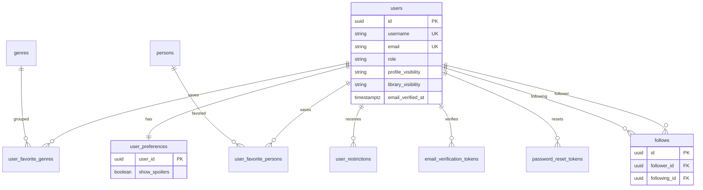
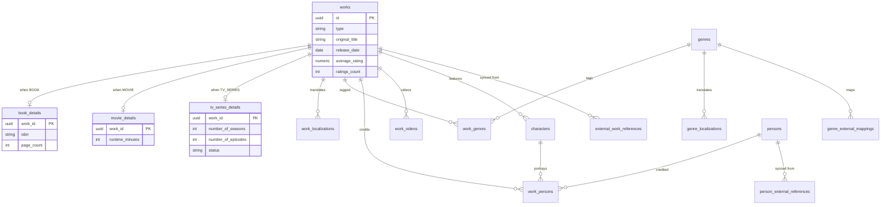
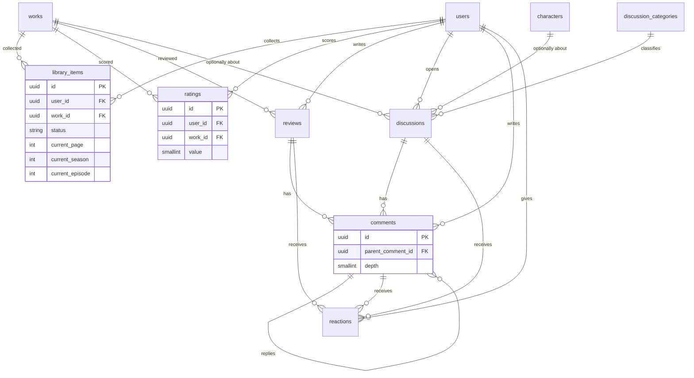
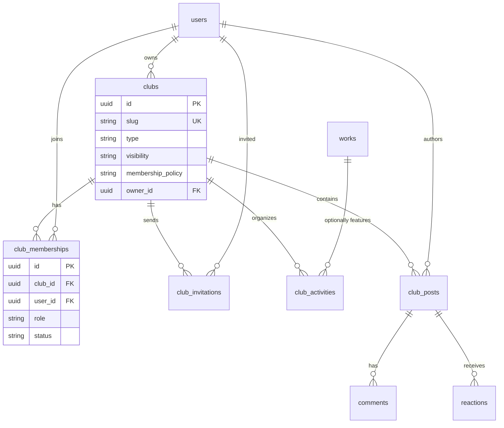
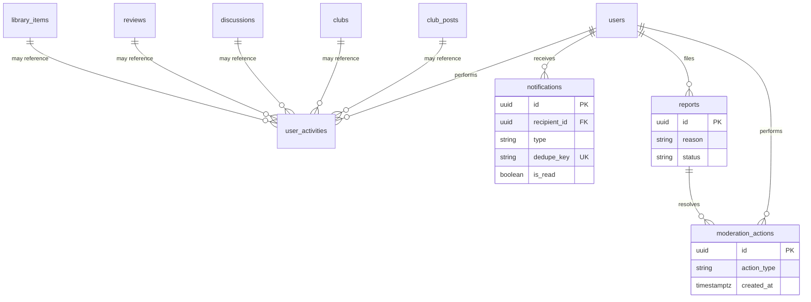

# CULTURE SPACE — Database Design

**Status:** APPROVED  
**Version:** 0.4  
**Approved:** 2026-11-02 by the product owner, as proposed  
**Engine:** PostgreSQL 17  
**Access:** TypeORM migrations only. `synchronize` is disabled in every environment.

This document is the approved relational design for CULTURE SPACE. Product rules that motivated a choice are recorded in `ARCHITECTURE.md`. The decision ids below match that document. No migration is authorized until Milestone 1 is explicitly started.

---

## 1. Conventions

| Topic | Rule |
| --- | --- |
| Primary keys | `uuid`, default `gen_random_uuid()` |
| Table names | plural `snake_case` |
| Column names | `snake_case` |
| Timestamps | `timestamptz`, named `created_at` and `updated_at` |
| Calendar dates | `date`, for release dates and reading dates |
| Money | none |
| Enums | `varchar` plus a `CHECK` constraint, not native PostgreSQL enums, so TypeORM migrations stay simple. The allowed values are still closed and tested |
| Text search | generated `tsvector` columns and GIN indexes |
| Extensions | `pgcrypto` is unnecessary on PostgreSQL 17 for UUID generation. Enable `pg_trgm` and `unaccent` |
| Junctions | Explicit tables with their own `id` and a unique pair, as required by the specification |
| Soft status | `PUBLISHED`, `HIDDEN`, `REMOVED` on user-generated content |

`updated_at` is maintained by the application inside the same transaction as the write. A database trigger is not required for it.

Usernames and emails are compared case-insensitively through unique indexes on `lower(username)` and `lower(email)`. The stored username keeps the user's casing. The stored email is normalized to lowercase before insert.

---

## 2. ER diagrams

The diagrams use the physical table names proposed by this document. They replace the duplicate `authors` and `directors` tables from the draft entity list with `persons` (decision D-03).

### 2.1. Identity and graph



### 2.2. Catalog



A work has at most one detail row, and the detail kind must match `works.type`. That second rule is a trigger because a foreign key cannot express it (decision D-04, D-09).

### 2.3. Library, reviews, discussions



### 2.4. Clubs



### 2.5. Feed, notifications, moderation



Notification, report, moderation, and activity subject columns are exclusive nullable foreign keys. The diagram shows the relationship family rather than every nullable column.

---

## 3. Tables

### 3.1. `users`

| Column | Type | Null | Notes |
| --- | --- | --- | --- |
| `id` | uuid | no | PK |
| `username` | varchar(30) | no | Display casing preserved |
| `full_name` | varchar(100) | no | |
| `email` | varchar(320) | no | Stored lowercase |
| `password_hash` | varchar(255) | no | Argon2id. Never selected by public queries |
| `avatar_url` | varchar(2048) | yes | MinIO object URL |
| `bio` | varchar(500) | yes | |
| `preferred_language` | varchar(5) | no | `en` or `ru`. Decision D-56 |
| `country_code` | char(2) | yes | ISO 3166-1 alpha-2 |
| `role` | varchar(20) | no | `USER`, `MODERATOR`, `ADMIN`. Default `USER` |
| `profile_visibility` | varchar(20) | no | `PUBLIC`, `PRIVATE`. Default `PUBLIC` |
| `library_visibility` | varchar(20) | no | `PUBLIC`, `PRIVATE`. Default `PUBLIC` |
| `account_status` | varchar(20) | no | `ACTIVE`, `SUSPENDED`. Default `ACTIVE` |
| `email_verified_at` | timestamptz | yes | Null until verification |
| `created_at` | timestamptz | no | |
| `updated_at` | timestamptz | no | |

Checks: `role`, `profile_visibility`, `library_visibility`, `account_status`, `preferred_language`.

Unique indexes: `lower(username)`, `lower(email)`.

There is no password column and no session column. Sessions live in Redis.

### 3.2. `user_preferences`

One row per user. `user_id` is the primary key and a foreign key to `users` with `ON DELETE CASCADE`.

| Column | Default | Meaning |
| --- | --- | --- |
| `show_spoilers` | false | Client mask bypass |
| `notify_new_follower` | true | |
| `notify_review_like` | true | |
| `notify_discussion_like` | true | |
| `notify_comment_reply` | true | |
| `notify_new_comment` | true | |
| `notify_club_invitation` | true | |
| `notify_club_membership` | true | |
| `notify_club_activity` | true | |
| `notify_club_announcement` | true | |
| `updated_at` | | |

Preferred language is not repeated here.

### 3.3. Favorites

`user_favorite_genres`

| Column | Notes |
| --- | --- |
| `id` | PK |
| `user_id` | FK `users` `ON DELETE CASCADE` |
| `genre_id` | FK `genres` `ON DELETE RESTRICT` |

Unique `(user_id, genre_id)`.

`user_favorite_persons`

| Column | Notes |
| --- | --- |
| `id` | PK |
| `user_id` | FK `users` `ON DELETE CASCADE` |
| `person_id` | FK `persons` `ON DELETE RESTRICT` |
| `capacity` | `AUTHOR` or `DIRECTOR` |

Unique `(user_id, person_id, capacity)`. A person may be favored as both an author and a director.

### 3.4. Tokens and restrictions

`email_verification_tokens` and `password_reset_tokens` share this shape:

| Column | Notes |
| --- | --- |
| `id` | PK |
| `user_id` | FK `ON DELETE CASCADE` |
| `token_hash` | `char(64)` SHA-256 hex, unique |
| `expires_at` | timestamptz |
| `used_at` | null until consumed |
| `created_at` | |

The raw token is emailed once and is never stored.

`user_restrictions`

| Column | Notes |
| --- | --- |
| `id` | PK |
| `user_id` | FK `ON DELETE RESTRICT` |
| `type` | `POSTING_SUSPENDED`, `LOGIN_SUSPENDED` |
| `reason` | varchar(2000) |
| `expires_at` | null means until revoked |
| `created_by_id` | FK `users` |
| `revoked_at` | null while active |
| `created_at` | |

Partial unique index: one active restriction of a given type per user, `WHERE revoked_at IS NULL`.

### 3.5. `follows`

| Column | Notes |
| --- | --- |
| `id` | PK |
| `follower_id` | FK `users` `ON DELETE CASCADE` |
| `following_id` | FK `users` `ON DELETE CASCADE` |
| `created_at` | |

Unique `(follower_id, following_id)`. Check `follower_id <> following_id`.

### 3.6. Genres

`genres`: `id`, `slug` unique, `created_at`.

`genre_localizations`: `genre_id`, `language_code`, `name`. Unique `(genre_id, language_code)`. Cascade on genre delete.

`genre_external_mappings`: `genre_id`, `provider` (`GOOGLE_BOOKS` or `TMDB`), `external_key`. Unique `(provider, external_key)`.

Discussion categories use the same localization pattern:

- `discussion_categories`: `id`, `slug` unique, `sort_order`
- `discussion_category_localizations`: unique `(category_id, language_code)`

Initial slugs: `literature`, `cinema`, `philosophy`, `characters`, `adaptations`, `recommendations`, `general`.

### 3.7. `persons` and external identities

`persons`: `id`, `name` varchar(255), `biography` text null, `image_url` varchar(2048) null, timestamps. Index on `lower(name)`. The name is not unique.

`person_external_references`: `person_id`, `provider`, `external_id`, unique `(provider, external_id)`. `ON DELETE CASCADE` from person.

### 3.8. `works`

| Column | Type | Null | Notes |
| --- | --- | --- | --- |
| `id` | uuid | no | PK |
| `type` | varchar(20) | no | `BOOK`, `MOVIE`, `TV_SERIES` |
| `original_title` | varchar(500) | no | Never replaced by a translation |
| `description` | text | yes | Description in the original record |
| `poster_url` | varchar(2048) | yes | Remote URL or empty |
| `release_date` | date | yes | Publication, release, or first air |
| `original_language` | varchar(16) | yes | BCP 47 / ISO 639 |
| `average_rating` | numeric(4,2) | no | Default 0. Range 0 to 10 |
| `ratings_count` | integer | no | Default 0. Check `>= 0` |
| `popularity_score` | numeric(12,4) | no | Default 0 |
| `created_at` | timestamptz | no | |
| `updated_at` | timestamptz | no | |
| `search_vector` | tsvector | no | Generated from title, description, and localizations via a maintained column updated in the sync transaction |

`search_vector` is updated in the catalog transaction rather than as a cross-table generated column, because localized titles live in another table. A trigger on `works` and `work_localizations` refreshes it. That keeps search consistent even if a future write path forgets it.

Checks: `type`, `average_rating >= 0 AND average_rating <= 10`, `ratings_count >= 0`.

### 3.9. `work_localizations`

| Column | Notes |
| --- | --- |
| `id` | PK |
| `work_id` | FK `ON DELETE CASCADE` |
| `language_code` | varchar(16) |
| `title` | varchar(500) |
| `description` | text null |

Unique `(work_id, language_code)`.

### 3.10. Detail tables

Each detail table uses `work_id` as its primary key and foreign key to `works` with `ON DELETE CASCADE`.

`book_details`

| Column | Notes |
| --- | --- |
| `isbn` | varchar(20) null. Digits only after normalization. Indexed, not unique |
| `publisher` | varchar(255) null |
| `page_count` | integer null. Check `> 0` when present |
| `edition` | varchar(255) null |
| `series_name` | varchar(255) null |
| `series_position` | varchar(32) null |
| `subtitle` | varchar(500) null |
| `language` | varchar(16) null. Language of this edition |

Publication date is `works.release_date`.

`movie_details`

| Column | Notes |
| --- | --- |
| `runtime_minutes` | integer null. Check `> 0` |
| `production_countries` | `char(2)[]` null |
| `production_companies` | `text[]` null |

Release date and original language stay on `works`.

`tv_series_details`

| Column | Notes |
| --- | --- |
| `first_air_date` | date null. Kept equal to `works.release_date` by the sync service |
| `last_air_date` | date null |
| `number_of_seasons` | integer null. Check `>= 0` |
| `number_of_episodes` | integer null. Check `>= 0` |
| `status` | `RETURNING`, `ENDED`, `CANCELED`, `PLANNED`, `UNKNOWN` |

Check `last_air_date >= first_air_date` when both are present.

`works.type` is immutable after insert. A trigger rejects an update of that column.

Detail integrity uses two triggers, not one immediate check that would fire before the detail row exists (decision D-61):

- Immediate, on each detail insert: `works.type` matches that detail table.
- Deferred until commit: the work has exactly one detail row, in the table that matches `works.type`.

The sync transaction inserts the work and its detail, then commits. A commit with zero details or two kinds of details rolls back.

### 3.11. `work_videos`

| Column | Notes |
| --- | --- |
| `id` | PK |
| `work_id` | FK cascade |
| `site` | `YOUTUBE` for the MVP |
| `video_key` | provider key |
| `video_type` | `TRAILER`, `TEASER`, `CLIP`, `OTHER` |
| `name` | varchar(255) null |
| `display_order` | integer not null default 0 |

### 3.12. `characters`

| Column | Notes |
| --- | --- |
| `id` | PK |
| `work_id` | FK cascade |
| `name` | varchar(255) |
| `description` | text null |
| `created_at` | |

Unique index on `(work_id, lower(name))`.

### 3.13. `work_persons`

| Column | Notes |
| --- | --- |
| `id` | PK |
| `work_id` | FK cascade |
| `person_id` | FK `ON DELETE RESTRICT` |
| `role` | `AUTHOR`, `DIRECTOR`, `WRITER`, `ACTOR`, `CREATOR`, `PRODUCER` |
| `character_id` | FK `characters` `ON DELETE SET NULL` |
| `display_order` | integer not null default 0 |

Partial unique indexes:

- `(work_id, person_id, role)` where `character_id is null`
- `(work_id, person_id, role, character_id)` where `character_id is not null`

A trigger ensures `character_id`, when set, belongs to the same `work_id`.

### 3.14. `work_genres`

`id`, `work_id`, `genre_id`. Unique `(work_id, genre_id)`. Both foreign keys cascade from work and restrict on genre.

### 3.15. `external_work_references`

| Column | Notes |
| --- | --- |
| `id` | PK |
| `work_id` | FK `ON DELETE CASCADE` |
| `provider` | `GOOGLE_BOOKS`, `TMDB_MOVIE`, `TMDB_TV` |
| `external_id` | varchar(64) |
| `last_synced_at` | timestamptz null |
| `sync_status` | `OK`, `FAILED` |
| `last_error` | varchar(500) null |

Unique `(provider, external_id)`. This is the idempotency key for synchronization.

### 3.16. `library_items`

| Column | Type | Null | Notes |
| --- | --- | --- | --- |
| `id` | uuid | no | PK |
| `user_id` | uuid | no | FK restrict |
| `work_id` | uuid | no | FK restrict |
| `status` | varchar(32) | no | See status matrix |
| `start_date` | date | yes | |
| `completion_date` | date | yes | |
| `current_page` | integer | yes | Books only |
| `current_season` | integer | yes | Series only |
| `current_episode` | integer | yes | Series only |
| `notes` | varchar(5000) | yes | Private to the owner regardless of library visibility |
| `progress_conflict` | boolean | no | Default false. Set by metadata sync when stored progress exceeds a newly shrunk total. Decision D-66 |
| `created_at` | timestamptz | no | |
| `updated_at` | timestamptz | no | |

Unique `(user_id, work_id)`.

Check `start_date <= completion_date` when both exist.

Check progress columns are null or positive as follows: `current_page >= 0`, `current_season >= 1`, `current_episode >= 1`.

Status matrix enforced by trigger `library_items_match_work`:

| Work type | Allowed status |
| --- | --- |
| `BOOK` | `WANT_TO_READ`, `CURRENTLY_READING`, `COMPLETED`, `ON_HOLD`, `DROPPED` |
| `MOVIE` | `WANT_TO_WATCH`, `WATCHED` |
| `TV_SERIES` | `WANT_TO_WATCH`, `WATCHING`, `COMPLETED`, `ON_HOLD`, `DROPPED` |

The same trigger:

- Clears progress columns that do not apply to the work type.
- Rejects a user write whose `current_page` exceeds `book_details.page_count` when page count is known.
- Rejects a user write whose `current_season` exceeds `tv_series_details.number_of_seasons` when season count is known.
- Allows an already stored over-limit value only while `progress_conflict` is true and that progress value is unchanged in the statement. Sync raises the flag. It does not change the page, the season, or the status.
- A user write that brings progress back within the total clears `progress_conflict`.
- Does not compare `current_episode` with `number_of_episodes`. That column is a series-wide total, and the MVP does not store episodes per season (decision D-06).
- Requires no progress columns for movies.

When status becomes `COMPLETED` or `WATCHED` and `completion_date` is null, the application sets `completion_date` to the current UTC date. The database allows a later edit. It does not guess the date itself.

### 3.17. `ratings`

| Column | Notes |
| --- | --- |
| `id` | PK |
| `user_id` | FK restrict |
| `work_id` | FK restrict |
| `value` | smallint. Check `between 1 and 10` |
| `created_at` | |
| `updated_at` | |

Unique `(user_id, work_id)`.

Deleting a rating is a hard delete. The work aggregate is updated in the same application transaction under `SELECT … FOR UPDATE` on the work row.

Incremental rules, with `numeric` arithmetic:

| Event | Count | Average |
| --- | --- | --- |
| Insert | `count + 1` | `((average * count) + value) / (count + 1)` |
| Update | unchanged | `((average * count) - old_value + new_value) / count` |
| Delete last rating | 0 | 0 |
| Delete | `count - 1` | `((average * count) - value) / (count - 1)` |

`popularity_score` uses:

```text
(count / (count + 10)) * average + (10 / (count + 10)) * global_mean
```

`global_mean` defaults to 7.0 until the nightly job has observed real ratings.

### 3.18. `reviews`

| Column | Notes |
| --- | --- |
| `id` | PK |
| `user_id` | FK restrict |
| `work_id` | FK restrict |
| `title` | varchar(200) null |
| `content` | text. Check `char_length` between 1 and 20000 |
| `contains_spoilers` | boolean not null default false |
| `visibility` | `PUBLIC` or `PRIVATE` |
| `status` | `PUBLISHED`, `HIDDEN`, `REMOVED` |
| `removed_by_moderator` | boolean not null default false |
| `comment_count` | integer not null default 0 |
| `reaction_count` | integer not null default 0 |
| `created_at` | |
| `updated_at` | |

Partial unique index `(user_id, work_id) WHERE status in ('PUBLISHED', 'HIDDEN')`.

A `REMOVED` row left by the author does not block a new review. A row with `removed_by_moderator = true` blocks creation until a moderator clears that lock. The block is application logic plus a partial unique index:

`(user_id, work_id) WHERE removed_by_moderator = true AND status = 'REMOVED'`.

### 3.19. `discussions`

| Column | Notes |
| --- | --- |
| `id` | PK |
| `user_id` | FK restrict |
| `title` | varchar(200) |
| `content` | text. Length 1 to 30000 |
| `type` | `WORK` or `GENERAL` |
| `category_id` | FK restrict |
| `related_work_id` | FK restrict, null |
| `related_character_id` | FK restrict, null |
| `contains_spoilers` | boolean not null default false |
| `visibility` | `PUBLIC` only in the MVP |
| `status` | `PUBLISHED`, `HIDDEN`, `REMOVED` |
| `comment_count` | integer not null default 0 |
| `reaction_count` | integer not null default 0 |
| `engagement_score` | integer not null default 0 |
| `created_at` | |
| `updated_at` | |
| `search_vector` | tsvector |

`engagement_score = comment_count * 2 + reaction_count`, maintained in the same transaction as the count change.

Trigger `discussions_shape`:

- `WORK` requires `related_work_id`.
- `GENERAL` requires `related_work_id` and `related_character_id` to be null.
- A character, when present, must belong to `related_work_id`.

### 3.20. `comments`

| Column | Notes |
| --- | --- |
| `id` | PK |
| `user_id` | FK restrict |
| `discussion_id` | FK restrict, null |
| `review_id` | FK restrict, null |
| `club_post_id` | FK restrict, null |
| `parent_comment_id` | FK restrict, null. Self-reference |
| `content` | text. Length 1 to 5000 |
| `contains_spoilers` | boolean not null default false |
| `status` | `PUBLISHED`, `HIDDEN`, `REMOVED` |
| `reaction_count` | integer not null default 0 |
| `depth` | smallint. Check `between 1 and 3` |
| `created_at` | |
| `updated_at` | |

Check exactly one of `discussion_id`, `review_id`, `club_post_id` is not null.

Trigger `comments_thread`:

- Depth 1 has no parent. Depth 2 and 3 require a parent.
- Parent depth is exactly `depth - 1`.
- Parent has the same non-null target foreign key.
- Parent status is not `REMOVED`.

### 3.21. `reactions`

| Column | Notes |
| --- | --- |
| `id` | PK |
| `user_id` | FK `ON DELETE RESTRICT` |
| `reaction_type` | `LIKE`, `INSIGHTFUL`, `INTERESTING`, `DISAGREE` |
| `review_id` | FK `ON DELETE RESTRICT`, null |
| `discussion_id` | FK `ON DELETE RESTRICT`, null |
| `comment_id` | FK `ON DELETE RESTRICT`, null |
| `club_post_id` | FK `ON DELETE RESTRICT`, null |
| `created_at` | |
| `updated_at` | |

Check exactly one target foreign key.

Partial unique indexes, one per target column, on `(user_id, <target_id>)`. The type is not part of the unique key, so types are mutually exclusive (decision D-12).

Changing a reaction updates `reaction_type`. Removing it deletes the row. Both adjust `reaction_count` on the target in the same transaction. The target column is `reviews.reaction_count`, `discussions.reaction_count`, `comments.reaction_count`, or `club_posts.reaction_count`.

### 3.22. Clubs

`clubs`

| Column | Notes |
| --- | --- |
| `id` | PK |
| `name` | varchar(80) |
| `slug` | varchar(100) unique |
| `description` | varchar(2000) |
| `avatar_url` | varchar(2048) null |
| `cover_url` | varchar(2048) null |
| `type` | `BOOK_CLUB`, `MOVIE_CLUB`, `MIXED_CLUB` |
| `visibility` | `PUBLIC`, `PRIVATE` |
| `membership_policy` | `OPEN`, `APPROVAL`, `INVITE_ONLY` |
| `owner_id` | FK `users` restrict. Must equal the user on the single active `OWNER` membership at commit |
| `member_count` | integer not null default 1 |
| `status` | `ACTIVE`, `DELETED` |
| `created_at` | |
| `updated_at` | |
| `search_vector` | tsvector |

Check: `NOT (visibility = 'PRIVATE' AND membership_policy = 'OPEN')`.

`club_memberships`

| Column | Notes |
| --- | --- |
| `id` | PK |
| `club_id` | FK restrict |
| `user_id` | FK restrict |
| `role` | `OWNER`, `ADMIN`, `MODERATOR`, `MEMBER` |
| `status` | `PENDING`, `ACTIVE`, `REJECTED`, `LEFT`, `REMOVED` |
| `joined_at` | timestamptz null |
| `created_at` | |
| `updated_at` | |

Unique `(club_id, user_id)`. Rejoining updates the same row.

Partial unique index: at most one row per club `WHERE role = 'OWNER' AND status = 'ACTIVE'`.

That index does not require the active owner to exist, and it does not compare the row with `clubs.owner_id`. Trigger `club_owner_consistent` is deferred until commit and supplies both missing rules (decision D-68):

- The club has exactly one `club_memberships` row with `role = 'OWNER'` and `status = 'ACTIVE'`.
- That row's `user_id` equals `clubs.owner_id`.

The same function is attached as a deferred constraint trigger on both tables:

| Table | When it is queued |
| --- | --- |
| `clubs` | `INSERT`, and `UPDATE` of `owner_id`. The check uses the new club id |
| `club_memberships` | `INSERT`, `UPDATE`, and `DELETE`. An update validates both the old `club_id` and the new `club_id`, including when `club_id` itself changes |

`INSERT` into `clubs` is required. Without it, a club row could commit alone, before any membership exists, and no membership trigger would run. Creation still inserts the club and the active owner membership in one transaction. Both checks wait until commit, so the membership inserted after the club is visible. A club inserted without that membership rolls back.

The trigger is deferred so a transfer can demote the current owner before it promotes the next one. The immediate unique index still rejects two active owners at any statement. A commit that leaves zero owners, or an `owner_id` that points at a different user, rolls back. Demoting or removing the only active owner is the zero-owner case and rolls back unless the same transaction appoints the replacement before commit.

Moving a membership from club A to club B updates `club_id` and therefore queues both clubs. Club A must still have its active owner after the move. Club B must still have its active owner, and the moved row must not become a second active owner or collide with an existing `(club_id, user_id)` pair. A legal move is a non-owner member who is not already in the destination club. Moving club A's only active owner to club B rolls back, and neither club changes.

`clubs.owner_id` stays because club reads need the owner without treating a missing membership as success. The membership row is the authority. The column is a constrained copy, not a second independent owner.

`club_invitations`

| Column | Notes |
| --- | --- |
| `id` | PK |
| `club_id` | FK restrict. A club is hidden by status, not removed |
| `invited_user_id` | FK restrict |
| `invited_by_id` | FK restrict |
| `status` | `PENDING`, `ACCEPTED`, `DECLINED`, `EXPIRED`, `REVOKED` |
| `expires_at` | timestamptz |
| `created_at` | |

Partial unique `(club_id, invited_user_id) WHERE status = 'PENDING'`.

`club_activities`

| Column | Notes |
| --- | --- |
| `id` | PK |
| `club_id` | FK restrict |
| `created_by_id` | FK restrict |
| `title` | varchar(200) |
| `description` | text |
| `type` | `READING_CHALLENGE`, `WATCHING_EVENT`, `BOOK_SELECTION`, `MOVIE_SELECTION`, `DISCUSSION_EVENT`, `GENERAL_EVENT` |
| `related_work_id` | FK restrict, null |
| `starts_at` | timestamptz |
| `ends_at` | timestamptz null |
| `status` | `SCHEDULED`, `ACTIVE`, `COMPLETED`, `CANCELLED` |
| `created_at` | |
| `updated_at` | |

Check `ends_at >= starts_at` when `ends_at` is present.

`club_posts`

| Column | Notes |
| --- | --- |
| `id` | PK |
| `club_id` | FK restrict |
| `author_id` | FK restrict |
| `post_type` | `DISCUSSION`, `ANNOUNCEMENT` |
| `title` | varchar(200) |
| `content` | text. Length 1 to 20000 |
| `contains_spoilers` | boolean not null default false |
| `status` | `PUBLISHED`, `HIDDEN`, `REMOVED` |
| `comment_count` | integer not null default 0 |
| `reaction_count` | integer not null default 0 |
| `created_at` | |
| `updated_at` | |

### 3.23. `notifications`

| Column | Notes |
| --- | --- |
| `id` | PK |
| `recipient_id` | FK `ON DELETE RESTRICT` |
| `actor_id` | FK `ON DELETE RESTRICT`. Users are not hard-deleted in the MVP |
| `type` | See list below |
| `is_read` | boolean not null default false |
| `read_at` | timestamptz null |
| `dedupe_key` | varchar(200) unique |
| `subject_detached` | boolean not null default false |
| `subject_snapshot` | jsonb not null. Display facts copied at insert: username, title, club name |
| `follow_id` | FK `ON DELETE RESTRICT`, null |
| `review_id` | FK `ON DELETE RESTRICT`, null |
| `discussion_id` | FK `ON DELETE RESTRICT`, null |
| `comment_id` | FK `ON DELETE RESTRICT`, null |
| `club_id` | FK `ON DELETE RESTRICT`, null. Context column, not the exclusive subject |
| `club_invitation_id` | FK `ON DELETE RESTRICT`, null |
| `club_membership_id` | FK `ON DELETE RESTRICT`, null |
| `club_activity_id` | FK `ON DELETE RESTRICT`, null |
| `club_post_id` | FK `ON DELETE RESTRICT`, null |
| `created_at` | |

Types and the required subject:

| Type | Required foreign key |
| --- | --- |
| `NEW_FOLLOWER` | `follow_id` |
| `REVIEW_LIKE` | `review_id` |
| `DISCUSSION_LIKE` | `discussion_id` |
| `COMMENT_REPLY` | `comment_id` |
| `NEW_COMMENT` | `comment_id` |
| `CLUB_INVITATION` | `club_invitation_id` |
| `CLUB_MEMBERSHIP_APPROVED` | `club_membership_id` |
| `CLUB_ACTIVITY_CREATED` | `club_activity_id` |
| `CLUB_ANNOUNCEMENT` | `club_post_id` |

Primary subject columns are `follow_id`, `review_id`, `discussion_id`, `comment_id`, `club_invitation_id`, `club_membership_id`, `club_activity_id`, and `club_post_id`. `club_id` may be set beside a club post, club activity, invitation, or membership. It does not satisfy the exclusive-subject rule by itself.

Trigger `notifications_subject`:

- `subject_detached = false`: exactly one primary subject is set, and it is the foreign key required by `type`.
- `subject_detached = true`: every primary subject is null, and `subject_snapshot` is present.
- A statement that nulls the primary subject must set `subject_detached` in the same update. The foreign keys themselves never use `ON DELETE SET NULL`, so a parent delete cannot clear the subject behind the application's back.

`dedupe_key` is `{type}:{recipient_id}:{subject_id}`. A repeated job does not insert a second row.

The application does not insert a row when `actor_id = recipient_id`. Preference flags are checked before insert. Unfollow, in one transaction, detaches `NEW_FOLLOWER` rows that point at that follow and then deletes the follow. Invitation expiry changes `club_invitations.status`. It does not delete the invitation or null the notification.

### 3.24. `user_activities`

| Column | Notes |
| --- | --- |
| `id` | PK |
| `user_id` | FK `ON DELETE RESTRICT`. The actor |
| `activity_type` | `WORK_COMPLETED`, `MOVIE_WATCHED`, `REVIEW_PUBLISHED`, `DISCUSSION_CREATED`, `CLUB_JOINED`, `CLUB_POST_PUBLISHED`, `CLUB_ACTIVITY_CREATED` |
| `work_id` | FK `ON DELETE RESTRICT`, null. Primary subject for `WORK_COMPLETED` and `MOVIE_WATCHED` |
| `library_item_id` | FK `ON DELETE RESTRICT`, null. Optional context for those two types. Not the exclusive subject |
| `review_id` | FK `ON DELETE RESTRICT`, null |
| `discussion_id` | FK `ON DELETE RESTRICT`, null |
| `club_id` | FK `ON DELETE RESTRICT`, null. Primary subject for `CLUB_JOINED`. Also set for club posts and club activities |
| `club_post_id` | FK `ON DELETE RESTRICT`, null. Primary subject for `CLUB_POST_PUBLISHED` |
| `club_activity_id` | FK `ON DELETE RESTRICT`, null. Primary subject for `CLUB_ACTIVITY_CREATED` |
| `snapshot` | jsonb not null. Display fields only: titles, type, slug |
| `created_at` | |

Trigger `activities_subject` requires exactly one primary subject for the activity type:

| Activity type | Primary foreign key | Extra required context |
| --- | --- | --- |
| `WORK_COMPLETED`, `MOVIE_WATCHED` | `work_id` | `library_item_id` while the library row exists |
| `REVIEW_PUBLISHED` | `review_id` | |
| `DISCUSSION_CREATED` | `discussion_id` | |
| `CLUB_JOINED` | `club_id` | |
| `CLUB_POST_PUBLISHED` | `club_post_id` | `club_id` of that post |
| `CLUB_ACTIVITY_CREATED` | `club_activity_id` | `club_id` of that activity |

No subject column uses `ON DELETE SET NULL`. That action would leave a live row with zero subjects and fail this trigger (decision D-59).

`removeFromLibrary` deletes the `WORK_COMPLETED` or `MOVIE_WATCHED` rows for that library item, then deletes the library item. `ON DELETE RESTRICT` aborts the library delete if an activity row still points at it (decision D-60). The rating row is not part of this delete.

The feed hides a row whose subject status is `HIDDEN` or `REMOVED`, whose club is private and the viewer is not a member, or whose actor profile is private and the viewer is not the actor. Privacy is evaluated at read time. The snapshot does not grant access. A removed library item has no remaining activity row, so the feed does not need a null-subject state.

### 3.25. `reports`

| Column | Notes |
| --- | --- |
| `id` | PK |
| `reporter_id` | FK restrict |
| `reason` | `SPAM`, `HARASSMENT`, `HATE_SPEECH`, `SPOILERS`, `INAPPROPRIATE_CONTENT`, `COPYRIGHT`, `OTHER` |
| `description` | varchar(2000) null |
| `status` | `OPEN`, `IN_REVIEW`, `RESOLVED`, `REJECTED` |
| `assigned_moderator_id` | FK set null |
| `resolution_note` | varchar(2000) null |
| `resolved_at` | timestamptz null |
| `reported_user_id` | FK restrict, null |
| `review_id` | FK restrict, null |
| `discussion_id` | FK restrict, null |
| `comment_id` | FK restrict, null |
| `club_post_id` | FK restrict, null |
| `created_at` | |

Check exactly one reported subject. Partial unique indexes stop a second `OPEN` or `IN_REVIEW` report from the same reporter against the same subject.

### 3.26. `moderation_actions`

Append-only.

| Column | Notes |
| --- | --- |
| `id` | PK |
| `moderator_id` | FK restrict |
| `action_type` | `HIDE`, `RESTORE`, `REMOVE`, `RESTRICT_USER`, `SUSPEND_USER`, `DISMISS_REPORT`, `ASSIGN_REPORT`, `CHANGE_ROLE` |
| `reason` | varchar(2000) |
| `report_id` | FK restrict, null |
| `target_user_id` | FK restrict, null |
| `review_id` | FK restrict, null |
| `discussion_id` | FK restrict, null |
| `comment_id` | FK restrict, null |
| `club_post_id` | FK restrict, null |
| `created_at` | |

`HIDE`, `RESTORE`, and `REMOVE` require exactly one of `review_id`, `discussion_id`, `comment_id`, or `club_post_id`, and `target_user_id` must be null. `RESTRICT_USER`, `SUSPEND_USER`, and `CHANGE_ROLE` require `target_user_id` and no content foreign key. Rows are never updated or deleted by the application. A trigger enforces that split so a content action cannot be stored against a user id.

### 3.27. `outbox_messages`

Decision D-62. This is the only queue-intent table. It is not an event bus.

| Column | Notes |
| --- | --- |
| `id` | PK |
| `message_type` | `SEND_EMAIL`, `INVALIDATE_SESSIONS`, `CREATE_NOTIFICATION`, `REFRESH_WORK` |
| `payload` | jsonb not null |
| `dedupe_key` | varchar(200) unique |
| `available_at` | timestamptz not null |
| `published_at` | timestamptz null |
| `attempts` | integer not null default 0. Enqueue failures only |
| `last_error` | varchar(500) null. Enqueue failures only |
| `processed_at` | timestamptz null. Set after the worker finishes the side effect |
| `processing_failed_at` | timestamptz null. Set by the failure listener, or by startup reconciliation when the job is `failed` or missing |
| `processing_error` | varchar(500) null. Final worker error |
| `created_at` | timestamptz not null |

Check `processed_at IS NULL OR processing_failed_at IS NULL`. A row is unpublished, in flight, processed, or permanently failed. It is not both processed and failed.

Partial index on `(available_at, id) WHERE published_at IS NULL`. Partial index on `(processing_failed_at, id) WHERE processing_failed_at IS NOT NULL`. Partial index on `(published_at, id) WHERE published_at IS NOT NULL AND processed_at IS NULL AND processing_failed_at IS NULL`.

The poller, inside one database transaction, claims unpublished rows with `FOR UPDATE SKIP LOCKED`. It enqueues one BullMQ job whose id is `outbox_messages.id`. If that id is already present, the poller treats the enqueue as success and does not insert another row. Only after Redis accepts the job does it set `published_at` and commit. `published_at` means the job was handed to BullMQ, not that the worker finished. The queue uses 5 attempts and exponential backoff. `removeOnFail` and `removeOnComplete` are both false, so a finished job stays readable as `failed` or `completed` instead of disappearing. The Redis instance that stores BullMQ must not evict those keys. Workers run in the API process. The worker commits `processed_at` before its function returns, so BullMQ does not move the job to `completed` until that commit is durable.

`attempts` and `last_error` record enqueue failures only. While `published_at` is null, the next poll retries the enqueue. After `published_at` is set, the poller does not enqueue that row again. BullMQ retries the worker until the attempt budget is exhausted. Exhaustion does not insert a second outbox row. The unique `dedupe_key` stays as it was.

When the final attempt fails, the failed-job listener in the API process sets `processing_failed_at` and `processing_error` on that same row. It does not insert a row.

Startup reconciliation does not start from the BullMQ failed set. That set cannot show a job Redis has already lost, and it cannot show that another job is still pending. Each API process, on startup, reads PostgreSQL for rows with `published_at` set, `processed_at` null, and `processing_failed_at` null. It locks each candidate with `FOR UPDATE SKIP LOCKED`, then reads that one BullMQ job by the outbox id. It repeats the job read immediately before any update. It never calls `queue.add` or `Job.retry()`.

| Job state | Reconciliation |
| --- | --- |
| `failed` | The listener missed the event. Set `processing_failed_at` and copy the job's failure reason into `processing_error` |
| `active` | Leave the row. A worker holds it |
| `waiting` | Leave the row. It is pending, including a stalled job that BullMQ moved back to wait |
| `delayed` | Leave the row. It is waiting for backoff |
| `completed` | Leave the row. Do not mark it failed and do not enqueue. `processed_at` is committed before completion, so this pair is an acknowledgement gap, not a permanent failure |
| missing | `getJob` returned null. Set `processing_failed_at` and `processing_error` to `job_missing`. This is the Redis-loss case, not a guess from an empty failed set |

The failure update is conditional: `processed_at IS NULL AND processing_failed_at IS NULL`. If a worker commits `processed_at` first, the mark changes zero rows. Two API processes can run this scan together. `SKIP LOCKED` gives each row to one of them. Active, waiting, delayed, and completed jobs are never classified as permanently failed. Unpublished rows stay with the poller, including the crash after enqueue and before `published_at` commits.

Recovery is the admin mutation `retryFailedOutboxMessage`. It locks the row and requires `published_at`, `processing_failed_at`, and a null `processed_at`. It then calls `Job.retry()` when that failed job still exists. Otherwise it enqueues again with the same job id and the existing payload. After Redis accepts the job, it clears `processing_failed_at` and `processing_error`. A failed enqueue leaves the failure mark in place. Recovery does not insert a row and does not change `dedupe_key` or `payload`. There is no automatic replay.

The worker returns immediately when `processed_at` is already set. Otherwise it performs the side effect and then sets `processed_at`. A second delivery is success, not a second domain event:

- `CREATE_NOTIFICATION` inserts one notification. A unique violation on `notifications.dedupe_key` is treated as already done. The worker also skips the insert when the subject row required by an attached notification no longer exists.
- `SEND_EMAIL` sends the message already described by the committed token. It does not create another token. SMTP has no idempotency key. A crash after the server accepts the message and before `processed_at` can deliver that same message again, both on a BullMQ retry and on operator recovery. That duplicate email is the accepted limit. The token row count stays one.
- `INVALIDATE_SESSIONS` deletes the Redis sessions for that user. Deleting a missing session is success.
- `REFRESH_WORK` upserts the same `(provider, external_id)` again.

A crash after enqueue and before `published_at` commits may deliver twice. A crash before enqueue leaves the row for the next poll. A crash after the domain side effect and before `processed_at` is safe for notifications, session deletion, and catalog upserts. It is not safe for SMTP, as stated above. Domain rows that caused the outbox insert are already committed in either case.

---

## 4. How referential integrity is preserved

### 4.1. Exclusive foreign keys and delete actions

Comments, reactions, notifications, reports, moderation actions, and activities look polymorphic in the product language. Physically, each possible parent is a real foreign key and a trigger allows exactly one primary subject.

`ON DELETE SET NULL` is forbidden on every column that this trigger treats as a primary subject. PostgreSQL would null the column and then reject the parent delete, or, if the check were removed, would leave an untyped row. `ON DELETE CASCADE` is also not used on those columns: a cascade would discard inbox and audit rows without an explicit transaction. The default is `ON DELETE RESTRICT`.

The one allowed `ON DELETE SET NULL` in this schema is `work_persons.character_id`. A character credit may lose its character link, and no exclusive-subject check requires that column.

When a parent row really is removed, the application deletes or rewrites the dependents in the same transaction before the parent delete. `RESTRICT` is the backstop when that step is forgotten.

This catches:

- A reaction pointing at a deleted review. The review is not hard-deleted, and the reaction foreign key would block it anyway.
- A comment whose discussion id and review id are both set.
- A notification whose type does not match its subject.
- An activity row with no subject.
- A library delete that still has a completion activity.

It does not use `target_id uuid` without a foreign key.

Notification history that must outlive a hard-deleted follow uses an explicit update, not a foreign-key action: the same statement sets `subject_detached` and clears `follow_id`, and only then is the follow deleted. The trigger accepts that pair. A raw `DELETE` of the follow fails while a notification still references it.

### 4.2. Triggers that a foreign key cannot express

| Trigger | Invariant |
| --- | --- |
| `works_detail_kind_immediate` | A detail row matches `works.type` |
| `works_one_detail_kind` | Deferred until commit. Exactly one detail row exists and matches `works.type` |
| `works_type_immutable` | `works.type` does not change after insert |
| `library_items_match_work` | Status and progress columns match the work type and known totals |
| `discussions_shape` | Work discussions have a work; general discussions do not; character belongs to that work |
| `comments_thread` | One target, parent shares it, depth is 1..3 and consistent |
| `work_persons_character_work` | Character credit belongs to the same work |
| `notifications_subject` | Notification type matches its foreign key |
| `activities_subject` | Activity type matches its foreign key |
| `club_owner_consistent` | Deferred until commit on `clubs` insert and `owner_id` update, and on membership insert, update, and delete. A changed `club_id` checks both clubs. The active `OWNER` membership exists and its user matches `clubs.owner_id` |
| `search_vector_refresh` | Catalog and discussion search documents stay current |

Triggers raise `check_violation` with a stable `ERRCODE` message. Services translate that message into a validation error. Application services still validate first so users receive field-level GraphQL errors without depending on the trigger as the only feedback.

### 4.3. Deletion behavior

| Parent | Child | Behavior |
| --- | --- | --- |
| User | Preferences, favorites, tokens | Cascade, only if a user row is ever removed by a future maintenance script |
| User | Library items, ratings, reviews, discussions, comments, reactions, follows, reports, notifications, activities | Restrict. The MVP does not delete users |
| Work | Details, localizations, credits, videos, characters, external refs, genres | Cascade. These rows are parts of the work |
| Work | Library items, ratings, reviews, activities | Restrict. A referenced work cannot disappear |
| Content row | Comments, reactions, reports, notifications, activities | Restrict. Public reads filter `REMOVED` and `HIDDEN`. The foreign key stays valid for moderators |
| Library item removed by the user | `WORK_COMPLETED` or `MOVIE_WATCHED` activity | The service deletes those activity rows, then deletes the library item. Restrict aborts a delete that skips the first step |
| Follow removed by unfollow | `NEW_FOLLOWER` notification | The service detaches the notification, then deletes the follow |
| Club | Memberships, posts, invitations, activities | Restrict. Club delete is a status change |
| Invitation expired | Notification | No foreign-key action. The invitation row remains with status `EXPIRED` |

Content delete in the product is a status change to `REMOVED`, not a physical delete. Physical delete is reserved for library items, follows, reactions, notifications the recipient removes, and tokens.

### 4.4. What is intentionally not a foreign key

`user_activities.snapshot` is JSON for display. Authorization never reads it.

Redis session keys are not database rows. Their lifetime is shorter than the user record, and the user id inside them is checked against `users` on every request.

---

## 5. Indexes

Primary keys and the unique constraints above already create indexes. Additional indexes:

| Index | Purpose |
| --- | --- |
| `users (account_status, created_at desc)` | Administration lists |
| `follows (following_id, created_at desc)` | Follower lists |
| `follows (follower_id, created_at desc)` | Following lists and feed membership |
| `works (type, release_date desc)` | Catalog browsing |
| `works (type, popularity_score desc)` | Popular works |
| `works (type, average_rating desc, ratings_count)` | Rating filters and sorts |
| `works (original_language)` | Language filter |
| `works` GIN `search_vector` | Full-text search |
| `works` GIN trigram on `original_title` | Prefix and fuzzy title search |
| `work_localizations (language_code, work_id)` | Localized title lookup |
| `work_localizations` GIN trigram on `title` | Fuzzy localized titles |
| `external_work_references (work_id)` | Sync status by work |
| `library_items (user_id, status, updated_at desc)` | Owner library |
| `library_items (work_id)` | Ratings context and “who saved this” later |
| `ratings (work_id)` | Reconciliation scan |
| `reviews (work_id, status, created_at desc)` | Work review list |
| `reviews (user_id, created_at desc)` | Profile reviews |
| `discussions (status, created_at desc, id desc)` | Cursor pages |
| `discussions (status, engagement_score desc, created_at desc)` | Popularity sort |
| `discussions (category_id, status, created_at desc)` | Category filter |
| `discussions (related_work_id, status, created_at desc)` | Work discussions |
| `discussions` GIN `search_vector` | Discussion search |
| `comments (discussion_id, created_at, id)` where discussion id is not null | Thread pages |
| `comments (review_id, created_at, id)` where review id is not null | Review threads |
| `comments (club_post_id, created_at, id)` where club post id is not null | Club threads |
| `comments (parent_comment_id, created_at)` | Replies |
| `reactions (review_id)`, and the same for discussion, comment, club post | Count repair |
| `clubs (status, visibility, type, member_count desc)` | Discovery |
| `clubs` GIN `search_vector` | Club search |
| `club_memberships (user_id, status)` | “My clubs” and feed club set |
| `club_memberships (club_id, status, role)` | Member administration |
| `club_activities (club_id, starts_at)` | Upcoming events |
| `club_posts (club_id, status, created_at desc)` | Club discussion list |
| `notifications (recipient_id, is_read, created_at desc, id desc)` | Inbox and unread count |
| `user_activities (user_id, created_at desc, id desc)` | Feed by followed user |
| `user_activities (club_id, created_at desc, id desc)` where club id is not null | Feed by club |
| `reports (status, created_at)` | Moderator queue |
| `moderation_actions (created_at desc)` | Audit |
| `persons` GIN trigram on `name` | Person search during onboarding |

Pagination limits are enforced in the API at 50 rows. Indexes are designed for the cursor predicate `(created_at, id) < (:cursorCreatedAt, :cursorId)`.

---

## 6. Transactions that must be atomic

| Use case | Writes in one transaction | After commit |
| --- | --- | --- |
| Register | User, preferences, verification token, `SEND_EMAIL` outbox row | Poller sends mail |
| Verify email | Token `used_at`, user `email_verified_at` | None |
| Reset password | Token `used_at`, password hash, `INVALIDATE_SESSIONS` outbox row | Poller deletes Redis sessions |
| Follow | Follow row and `CREATE_NOTIFICATION` outbox row | Worker inserts `NEW_FOLLOWER` if the follow still exists |
| Unfollow | Detach `NEW_FOLLOWER` notifications, delete unpublished outbox rows for that follow, delete the follow | None |
| Open or refresh a work | Work, exactly one detail row, localizations, genres, people, characters, external reference, and search vector. Deferred detail trigger runs at commit. Once `library_items` exists, the same transaction also sets or clears `progress_conflict`. Before that table exists, it does not | None on the user request. `refreshWork` only inserts `REFRESH_WORK` |
| Set rating | Rating upsert or delete, locked work aggregate | None |
| Update library item | Library row, optional rating, completion activity when the status becomes completed or watched | None |
| Remove library item | Delete completion or watched activities for that item, then delete the library item. Ratings stay | None |
| Publish review or discussion | Content row and activity row | None |
| Comment | Insert or soft-delete adjusts the parent `comment_count` in the same transaction. Create also writes a `CREATE_NOTIFICATION` outbox row | Worker inserts the notification. A duplicate `dedupe_key` is a no-op |
| React | Reaction upsert or delete, target counts. `CREATE_NOTIFICATION` only for `LIKE` on a review or discussion | Worker inserts the notification |
| Create club | Club with `owner_id`, active `OWNER` membership, `CLUB_JOINED` activity. Deferred owner trigger runs at commit | None |
| Transfer ownership | Demote the current owner membership to `ADMIN`, promote the target active member to `OWNER`, set `clubs.owner_id`. Deferred owner trigger runs at commit | None |
| Moderate | Content or user state, plus one `moderation_actions` row of the matching kind | None |

A GraphQL query does not insert into these tables, does not enqueue BullMQ, and does not call a provider in a field resolver. `searchWorks` may write a Redis cache entry. That cache is not a domain write.

The sync transaction never changes `works.type`, library status, `current_page`, `current_season`, or `current_episode`. Confirmed Q-24 option A: once `library_items` exists, a lower `page_count` or `number_of_seasons` sets `progress_conflict` in that same transaction, and a total that again covers the stored progress clears the flag. User content is not clamped. The catalog milestone skips this update because the table is not there yet.

---

## 7. Nightly repair

One BullMQ repeatable job:

1. Recompute `global_mean` from `ratings`.
2. Recompute `average_rating`, `ratings_count`, and `popularity_score` for works whose stored count differs from `count(*)` on `ratings`.
3. Recompute `comment_count` and `reaction_count` on reviews, discussions, and club posts, and `reaction_count` on comments, where they differ from the live rows.
4. Recompute `clubs.member_count` for active memberships.
5. Expire invitations whose `expires_at` has passed.
6. Delete used or expired tokens older than 7 days.

The job is bounded by batches so it cannot hold long locks. It is a repair tool. The request path does not wait for it.

---

## 8. Migration policy

1. Every schema change is a TypeORM migration reviewed with the feature that needs it.
2. `synchronize` stays false in development, test, and production.
3. Migrations that only add nullable columns or new tables are labeled expand-only.
4. Migrations that drop, rewrite, or tighten constraints are labeled destructive and require a fresh backup before production execution.
5. Partial indexes, checks, and triggers are written in explicit SQL inside the migration. They are not left to entity `synchronize` hints.
6. Seeds are idempotent TypeScript scripts invoked by command, not SQL inserted into unrelated migrations.
7. Integration tests apply the full migration chain to an empty database.

No migration is created in this document. The first migration waits for the instruction to start Milestone 1.

---

## 9. Mapping from the draft entity list

| Draft concept | Proposed table | Note |
| --- | --- | --- |
| `User` | `users` | Adds account status and library visibility |
| `UserPreference` | `user_preferences` | Language is not duplicated. Favorite genres are normalized |
| `Work` | `works` | Adds popularity score and search vector |
| `WorkLocalizedTitle` | `work_localizations` | Adds description |
| `BookDetails`, `MovieDetails`, `TVSeriesDetails` | same names in snake case | `work_id` is the primary key. Duplicate dates and languages removed |
| `Author`, `Director`, `Person` | `persons` | Roles move to `work_persons` |
| `WorkPerson` | `work_persons` | |
| `Genre`, `WorkGenre` | `genres`, `work_genres` | Plus localization and provider map |
| `ExternalWorkReference` | `external_work_references` | |
| `LibraryItem` | `library_items` | Typed progress columns. Rating removed |
| `Review` | `reviews` | Visibility and moderation lock added |
| `Discussion` | `discussions` | Category is a foreign key |
| `Comment` | `comments` | Depth column added |
| `Reaction` | `reactions` | Exclusive foreign keys |
| `Follow` | `follows` | |
| `Club`, `ClubMembership`, `ClubInvitation`, `ClubActivity`, `ClubPost` | matching tables | |
| `Notification` | `notifications` | Exclusive foreign keys, detach flag, and `dedupe_key` |
| `UserActivity` | `user_activities` | Exclusive foreign keys, `work_id`, and snapshot |
| Queue intent | `outbox_messages` | Transactional outbox. Decision D-62 |
| `Report`, `ModerationAction` | `reports`, `moderation_actions` | Exclusive foreign keys |
| Character mentioned by discussions | `characters` | Missing in the draft column list, required by `relatedCharacterId` |
| Rating as its own fact | `ratings` | Required to keep one score independent of library membership |
| Season, Episode | deferred | Decision D-06 |

---

## 10. Database questions after approval

The product owner approved version 0.4 as proposed on 2026-11-02. The section 20 answers for Q-01, Q-02, Q-03, Q-06, Q-14, Q-16, and Q-20 are accepted and match this schema. Q-23 stays closed: series watch time is not stored or returned. Q-21 does not change these tables. It only chooses the genre seed in Milestone 3.

Q-22 and Q-24 are confirmed as option A. Unfollow detaches `NEW_FOLLOWER` and keeps the snapshot. It does not delete that notification. A shrinking catalog total sets `progress_conflict` and does not clamp progress or status. The `progress_conflict` write is implemented in the milestone that creates `library_items`, because the catalog milestone does not have that table yet.
