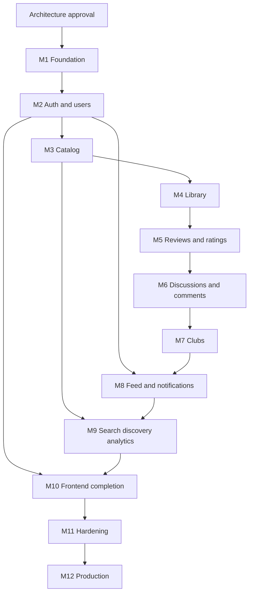

# CULTURE SPACE — Development Plan

**Status:** APPROVED  
**Version:** 0.4  
**Approved:** 2026-11-02 by the product owner, as proposed

This plan turns `PROJECT_SPEC.md` into a sequence of milestones. The architecture in `ARCHITECTURE.md`, the schema in `DATABASE.md`, and the contract in `GRAPHQL_API.md` are approved at version 0.4.

No milestone starts until the product owner gives a separate explicit instruction. The first such milestone is Milestone 1 — Foundation.

---

## 1. Working rules

1. Implement one backend milestone at a time.
2. Do not start a backend milestone whose dependency is unfinished.
3. Frontend work for a stable contract may proceed beside the next backend milestone. It does not run ahead of an unstable contract.
4. Tests for a behavior land in the same milestone as the behavior. Milestone 11 hardens the suite; it does not introduce it.
5. Each milestone ends with documentation updates when the implementation differs from the approved design. The difference is explained before the code changes the design.
6. Dependencies are added in the milestone that first needs them, not in a single upfront install of the whole stack.
7. `synchronize` stays off. The first migration appears in Milestone 1 only as empty infrastructure, or in Milestone 2 when the first entity exists. Architecture version 0.4 is approved. No migration is written until Milestone 1 is explicitly started.
8. A milestone is done when its acceptance checks pass, not when the files exist.

### 1.1. Suggested order

M8 waits for clubs because club events are part of the feed, and it waits for users because follows exist from M2. M10 can start its shell after M2 and grow page by page as each contract stabilizes. M9 waits for catalog data and for the social records it ranks.

---

## 2. Milestone 1 — Foundation

**Goal.** A bootable modular monolith with verified tooling, an empty database toolchain, and a development stack. No product feature.

**Implementation status.** Milestone 1 foundation code is in the repository. Verification details, including checks that could not be run in this environment, are in `MILESTONE_1_REPORT.md`. Approved decisions are unchanged.

**Depends on.** Explicit architecture approval.

**Deliverables.**

- pnpm workspace: `apps/api`, `apps/web`.
- NestJS application with the module folders from `ARCHITECTURE.md` and no business behavior.
- Config validation that refuses to boot without required variables.
- TypeORM data source with `synchronize: false` and a migrations directory.
- GraphQL Code First endpoint with a trivial health query removed before production, plus HTTP `/health` and `/ready`.
- Redis connection and session middleware wired without a login feature.
- Docker Compose for PostgreSQL, Redis, MinIO, Mailpit, the API, and the web shell.
- Strict TypeScript, ESLint, and Prettier.
- CI workflow that installs, lints, typechecks, and builds. Test jobs are present and stay green when there are no tests yet.
- `.env.example` without secrets.

**Out of scope.** User entities, migrations of product tables, provider clients, visual design.

**Acceptance.**

- `docker compose up` starts PostgreSQL, Redis, MinIO, and Mailpit.
- The API serves `/ready` only when PostgreSQL and Redis answer.
- The web app renders a placeholder localized in English and Russian.
- CI passes on a clean checkout.
- Production configuration still has `synchronize: false`.

**Tests.** A smoke integration test for `/ready` against the compose database.

---

## 3. Milestone 2 — Authentication and users

**Goal.** A person can register, verify email, log in, recover a password, edit a profile, and follow someone.

**Depends on.** Milestone 1.

**Deliverables.**

- Migrations for users, preferences, favorites, tokens, restrictions, follows, and `outbox_messages`.
- Outbox poller, BullMQ consumer for `SEND_EMAIL` and `INVALIDATE_SESSIONS`, failed-job marker, startup reconciliation, and admin retry of a permanently failed row.
- Argon2id hashing.
- Redis sessions with regeneration, idle TTL, absolute TTL, and logout-all.
- Mail port with Mailpit in development.
- Guards for authenticated, verified, and role access.
- GraphQL operations from the auth and users sections of `GRAPHQL_API.md`.
- Rate limits for register, login, and reset.
- Bootstrap command for the first administrator.

**Out of scope.** Catalog, library, clubs, and the public visual design beyond simple auth screens needed to exercise the API.

**Acceptance.**

- Duplicate email and username are rejected.
- Unverified users can edit a profile and cannot follow.
- Login does not reveal whether an email exists when the password is wrong.
- Password reset commits an `INVALIDATE_SESSIONS` outbox row, and the worker removes the Redis sessions.
- A crash after that commit and before the worker runs still results in session removal on the next poll.
- A worker that fails all 5 attempts leaves one outbox row with `processing_failed_at` set and does not insert a second row.
- Startup reconciliation marks a `failed` job whose listener did not run, and marks a published row whose job id is absent from Redis. It does not mark `active`, `waiting`, `delayed`, or `completed` jobs, and it does not enqueue.
- `retryFailedOutboxMessage` on that row runs the side effect once and keeps the original `dedupe_key`.
- A second delivery after a crash past the session delete does not recreate sessions and does not create a second outbox row.
- A crash after SMTP accepts a message and before `processed_at` may send the same token email again. The token table still has one row.
- Demoting a user takes effect on the next request without a leftover role in the session.
- Public profile queries do not contain `email` or `passwordHash`.
- A user cannot follow themselves, and a second follow does not create a second row.

**Tests.** Unit tests for password policy and privacy filtering. Integration tests for session creation, logout, unique constraints, permanent outbox failure, admin recovery, duplicate delivery, and a worker crash before and after the side effect. Reconciliation tests: a missed failure event, a job id absent from Redis, and one case each for `active`, `waiting`, `delayed`, and `completed` that must stay unmarked. A second instance scanning the same rows creates no extra outbox row and does not overwrite `processed_at`. API journey for register, verify, login, and follow.

**Frontend track.** Auth pages, language switcher, and the Apollo client with cookie credentials may start once these operations stop changing.

---

## 4. Milestone 3 — Cultural catalog

**Goal.** Books, movies, and series can be found and opened without calling the provider on every page view.

**Depends on.** Milestone 2, because rate limits and configuration patterns already exist. Catalog reads are public, so they do not depend on profiles beyond the shared foundation.

**Deliverables.**

- Migrations for works, details, localizations, people, characters, genres, mappings, videos, and external references.
- Immediate and deferred triggers for one matching detail row, plus an immutable `works.type`.
- Refresh updates catalog rows only. It does not read or write `library_items`, which does not exist yet.
- No series runtime column. Episode length is not stored for a statistic the library cannot calculate.
- Google Books and TMDB clients with Zod validation, timeouts, retries, and Redis rate budgets.
- `searchWorks`, `openExternalWork`, `work`, `books`, `movies`, `series`, and `genres`.
- Idempotent upsert on `(provider, external_id)`.
- Stale refresh job for catalog rows older than 30 days. It does not filter on library membership.
- Seed script for the approved genre vocabulary and provider mappings.

**Out of scope.** Library status, `progress_conflict`, reviews, episode tables, manual metadata editing. The flag is added with `library_items` in Milestone 4.

**Acceptance.**

- The `work` query does not call a provider, insert a row, or insert an outbox message.
- A committed work without a detail row rolls back.
- A provider timeout still returns local search hits.
- The same external id cannot create two works.
- A book row cannot also have movie details.
- Original title remains available when a Russian localization exists.
- Missing page counts, posters, and biographies are null and do not fail the page.

**Tests.** Fixture-based client tests. Integration tests for upsert, the detail-kind trigger, and one failed `REFRESH_WORK` recovery that still leaves a single work for that external id. No test in this milestone creates `library_items`. No live provider calls in CI.

**Frontend track.** Catalog browse and work detail pages.

**Product gate inside the milestone.** The canonical genre list (question Q-21) is confirmed before the seed is written.

---

## 5. Milestone 4 — Personal library

**Goal.** A verified user can save a work, change its status, track valid progress, and remove it without deleting the work.

**Depends on.** Milestone 3.

**Deliverables.**

- `library_items` migration and `library_items_match_work` trigger.
- Starting in this milestone, extend the catalog refresh transaction to set or clear `progress_conflict` without changing progress numbers or status. This is confirmed Q-24 option A. Earlier milestones do not run this write.
- Narrow the nightly refresh to works that have at least one library row. Milestone 3 refreshes by age only.
- `myLibrary`, `userLibrary`, `addToLibrary`, `updateLibraryItem`, `removeFromLibrary`.
- Privacy enforcement for private profiles and private libraries.
- Optional rating argument is stubbed only if Milestone 5 is not merged yet. If Milestone 5 is not started, `updateLibraryItem` rejects `rating` until ratings exist. Do not invent a second rating column as a temporary shortcut.

**Out of scope.** Social feed entries. Those are written in Milestone 8. The library service should call `ActivityRecorder` only after that port exists, or the milestone can land the port with a no-op implementation that Milestone 8 replaces. Preferred path: land the `ActivityRecorder` port in this milestone with the real table delayed to Milestone 8 and a no-op adapter now. The completion activity is then switched on in Milestone 8 without rewriting library rules.

**Acceptance.**

- One library row per user and work.
- Movie status `CURRENTLY_READING` is rejected.
- Progress cannot exceed a known page count or season count.
- Start date after completion date is rejected.
- Removing a library item leaves the work and any rating in place.
- The library response includes `progressConflict` when sync has flagged the row.
- Shrinking `page_count` below `current_page` sets `progress_conflict` and leaves the page and status unchanged. This test runs only after `library_items` and its trigger exist.
- Another user cannot read notes, and cannot read the library when visibility forbids it.

**Tests.** Unit tests for the status matrix. Integration tests for the trigger, the unique pair, and the Q-24 shrink case. API journey for add, update progress, complete, and remove.

**Frontend track.** My library and the public library tab.

---

## 6. Milestone 5 — Reviews and ratings

**Goal.** A verified user can rate a work and publish one active review. Aggregates stay correct without a catalog-wide recalculation.

**Depends on.** Milestone 3. Soft-depends on Milestone 4 for the combined library update. Ratings themselves do not require a library row.

**Deliverables.**

- `ratings` and `reviews` migrations, including partial unique indexes.
- Transactional aggregate update with row locks.
- Nightly repair job skeleton.
- Review and rating operations.
- `updateLibraryItem.rating` wired through `RatingsService`.

**Out of scope.** Comment threads on reviews. The review can exist before comments. Reaction counts stay at zero until Milestone 6.

**Acceptance.**

- A second active review for the same user and work is rejected.
- Updating a score does not change `ratings_count`.
- Deleting the last score sets the average to 0.
- Two concurrent ratings of a new work do not lose an increment. This is tested with overlapping transactions.
- A private review is absent from the public work page.
- Hidden and removed reviews are absent from public lists.

**Tests.** Unit tests for the average formula. Integration test for the unique partial index and the lock. API journey for rate, review, edit, and delete.

**Frontend track.** Review composer, spoiler mask, and rating control.

---

## 7. Milestone 6 — Discussions, comments, reactions, reports

**Goal.** The public conversation features work, including nested replies and a moderation foundation.

**Depends on.** Milestones 2 and 5. Work-linked discussions also need Milestone 3.

**Deliverables.**

- Discussion, category, comment, reaction, report, and moderation-action migrations.
- Thread and discussion-shape triggers.
- Discussion, comment, and reaction operations.
- `reportContent`, moderator queue, hide, restore, and remove.
- User restriction for posting.

**Out of scope.** Club posts. The comment target already allows `club_post_id`, and club writes arrive in Milestone 7.

**Acceptance.**

- A general discussion with a work id is rejected.
- A work discussion without a work id is rejected.
- A reply at depth 4 is rejected.
- A reply cannot jump to another discussion.
- One user has one reaction on a target, and changing the type does not create a second row.
- Removed discussions disappear from public lists.
- A non-moderator cannot hide another person's discussion.
- Reporting does not expose the report queue to the reporter.
- A moderator reading a report receives the exact target, including a removed review.
- `hideContent` rejects a user id. User suspension uses `SuspendUserInput` and returns `AccountSummary`.

**Tests.** Unit tests for depth and reaction replacement. Integration tests for triggers. API journeys for discussion, reply, reaction, report, and hide.

**Frontend track.** Discussion list, thread page, composer, and report dialog.

---

## 8. Milestone 7 — Clubs

**Goal.** A verified user can create a club, join it according to its policy, invite members, post, and schedule an activity.

**Depends on.** Milestones 2, 3, and 6.

**Deliverables.**

- Club, membership, invitation, activity, and post migrations.
- Partial unique owner index, private-club policy check, and deferred trigger `club_owner_consistent`.
- Club operations and role matrix.
- Image upload flow for club avatar and cover.
- Club announcements write `CREATE_NOTIFICATION` outbox rows in the club transaction. The inbox queries stay in Milestone 8. Migrate `notifications` in this milestone so the worker has a destination table.

**Out of scope.** Per-member reading progress inside an activity.

**Acceptance.**

- The creator is the only active owner, and `clubs.owner_id` matches that membership after commit.
- A transfer that updates only `owner_id`, or only the membership role, rolls back.
- Two active owners cannot be inserted, including inside the transfer transaction.
- A private club cannot use `OPEN`.
- A non-member receives not-found for a private club's posts.
- A member cannot promote themselves.
- The owner cannot leave before transfer.
- A second pending invitation for the same person does not create a second row.
- Invitation expiry is enforced by the repair job.

**Tests.** Unit tests for the role matrix. Integration tests commit real transactions against `club_owner_consistent`:

- A club inserted without an owner membership rolls back.
- A club inserted with its active `OWNER` membership, and matching `owner_id`, commits.
- Removing or demoting the only active owner rolls back.
- Updating only `clubs.owner_id` rolls back.
- A valid transfer commits: the previous owner becomes `ADMIN`, an existing active member becomes `OWNER`, and `owner_id` matches that member.
- Moving a non-owner member from club A to club B commits, and both clubs still have exactly one active owner matching `owner_id`.
- Moving club A's only active owner membership to club B rolls back, and both clubs are unchanged.

API journeys for create, join, approve, invite, post, and deny non-member access.

**Frontend track.** Club discovery, club pages, and settings.

---

## 9. Milestone 8 — Following feed and notifications

**Goal.** Followed people and joined clubs produce a paginated home feed, and important events create a durable notification with a realtime hint.

**Depends on.** Milestones 2, 4, 5, 6, and 7.

**Deliverables.**

- `user_activities` migration if it was not created earlier, and the real `ActivityRecorder`.
- Retrofit of library completion, review publish, discussion create, club join, club post, and club activity to record events. Completion activities store `work_id` and `library_item_id`.
- `removeFromLibrary` deletes those activity rows before the library row.
- Notification creation goes through `CREATE_NOTIFICATION` outbox rows. Unfollow detaches the existing follower notification and deletes any unpublished outbox row for that follow.
- GraphQL `UserActivity` and `Notification` expose `clubPost` and `clubActivity`.
- `notifications` queries, unread count, mark read, delete.
- GraphQL subscription `notificationReceived` through Redis Pub/Sub.
- Nginx WebSocket headers documented for production, even though production deploy is Milestone 12.
- Preference flags honored before insert.
- The same `CREATE_NOTIFICATION` delivery twice inserts one notification. The worker treats a duplicate `dedupe_key` as success.
- A permanently failed `CREATE_NOTIFICATION`, followed by `retryFailedOutboxMessage`, inserts one notification and does not add an outbox row.
- Unfollow uses confirmed Q-22 option A. It detaches the follower notification, keeps the snapshot, and then deletes the follow.

**Out of scope.** Email for every notification. Wishlist items in the feed. Reaction feed events.

**Acceptance.**

- A completion by a followed user appears once.
- Removing that library item removes the completion from the follower's feed and still leaves the work and the rating.
- Unfollow does not fail because a follower notification still points at the follow.
- A private-club post is absent from a follower's feed when that follower is not a member.
- A removed review disappears from the feed.
- A user is not notified about their own comment.
- An offline user sees the notification after the next login.
- The subscription receives a newly inserted row for the current user and for nobody else.

**Tests.** Integration tests for feed visibility, duplicate notification delivery, and recovery of a permanently failed `CREATE_NOTIFICATION`. API journey from “follow and complete a book” to “the follower's feed and notification.” Subscription test with two sessions.

**Frontend track.** Home feed, notification inbox, and badge.

---

## 10. Milestone 9 — Discovery, recommendations, and statistics

**Goal.** Global search, popular sections, rule-based recommendations, and personal statistics.

**Depends on.** Milestones 3, 4, 5, 6, and 8. Recommendations degrade gracefully when the social graph is empty, but the milestone should land after the signals exist.

**Deliverables.**

- `search` across works, users, discussions, and public clubs.
- Popular and recently added catalog queries already supported by indexes, exposed as the discovery home sections.
- Recommendation service and cache.
- `myStatistics` and `userStatistics`.
- Index review with `EXPLAIN` on the feed, catalog popular query, and discussion search. Missing indexes are added by migration in this milestone.

**Out of scope.** Machine learning, Elasticsearch, and annual public reports.

**Acceptance.**

- Search does not return private clubs or email addresses.
- Recommendations exclude works already in the caller's library.
- A private profile's statistics are rejected for other viewers.
- Pages read ignore books with an unknown page count and still count those books as completed.
- Series statistics return completed and currently watching counts. They do not return watch time or a total episode count.
- Discovery pages render when the provider is disabled.

**Tests.** Unit tests for the scoring function with fixed inputs. Integration test for recommendation exclusion. API journey for search and statistics.

**Frontend track.** Discovery home, search results, recommendations, and statistics dashboard.

---

## 11. Milestone 10 — Frontend completion

**Goal.** The responsive English and Russian application covers every page in the specification.

**Depends on.** The contract of each page. The milestone is finished only after Milestone 9, because that is the last product contract. Page implementation starts earlier, beside the backend milestones.

**Deliverables.**

- Design system: layout, typography, forms, dialogs, spoiler disclosure, pagination, empty, loading, and error states.
- All public, authenticated, and club routes from `ARCHITECTURE.md`.
- Apollo cache updates after the main mutations, or a deliberate refetch where cache updates are riskier than a refetch.
- Localized dates and numbers.
- Keyboard access for dialogs, menus, and forms.
- Destructive confirmation for delete actions.
- Responsive layouts checked at mobile and desktop widths.

**Out of scope.** Native applications and a second visual theme.

**Acceptance.**

- A new user can complete the specification's main journeys in both languages without using a GraphQL client directly.
- Refresh preserves the session through the HttpOnly cookie.
- Private and empty states are understandable.
- Spoilers are masked until revealed, unless the user enabled the preference.
- Forms show validation messages from `extensions.i18nKey`.

**Tests.** React Testing Library for shared states and one form. Manual journey checklist recorded in the milestone notes. Browser verification is required for the pages delivered here.

---

## 12. Milestone 11 — Hardening

**Goal.** Close the gaps that feature milestones are too close to see: authorization matrix, query cost, and the full journey suite.

**Depends on.** Milestone 10.

**Deliverables.**

- API journey tests for every flow in specification section 29.
- Authorization matrix test: anonymous, unverified, user, non-member, member, moderator, and administrator against private libraries, private reviews, and private clubs.
- Query depth, complexity, and rate-limit tests.
- Dependency review and a written threat pass over sessions, uploads, and provider credentials.
- Performance pass: no N+1 on work detail, review list, discussion thread, and home feed. Evidence is the query log for one request of each.
- Fix list from that pass, limited to defects. No new product scope.

**Acceptance.**

- The journey suite passes in CI.
- A `work` query produces no inserts.
- Removing a library item that has a completion activity commits.
- A work insert that commits without a detail row rolls back.
- A request for a private club post by a non-member does not include the post body in any nested field.
- A crafted deep query is rejected.
- The feed and work-detail request logs show batched loads rather than one query per card.

---

## 13. Milestone 12 — Production and CI/CD

**Goal.** The approved application can be built, deployed, restored, and observed on a Linux VPS.

**Depends on.** Milestone 11.

**Deliverables.**

- Multi-stage Dockerfiles running as non-root.
- `docker-compose.prod.yml` with Nginx, TLS, internal data network, health checks, and volume names.
- GitHub Actions deploy workflow triggered by a version tag or a manual run.
- Images published to GHCR and tagged with the commit SHA.
- Server deploy script: backup, pull, migrate, recreate, readiness check.
- Written rollback and restore procedure.
- Daily `pg_dump` and MinIO backup policy.
- Production environment template without secret values.
- One successful deployment to the target VPS and one practiced restore on a disposable database.

**Out of scope.** Kubernetes, zero-downtime claims, and a staging cluster unless the product owner adds a second server.

**Acceptance.**

- PostgreSQL, Redis, and the MinIO console are not reachable from the public internet.
- HTTPS serves the web application and `/graphql`.
- A deployment with a failing migration does not leave the previous volume deleted.
- CI remains required before a deploy workflow can be trusted; the deploy workflow uses the already built commit.
- Secrets are absent from the Git history.

---

## 14. What each milestone must update

| Change | Document |
| --- | --- |
| Module boundary or runtime choice | `ARCHITECTURE.md` |
| Table, constraint, or index | `DATABASE.md` |
| Query, mutation, or auth rule | `GRAPHQL_API.md` |
| Sequence or acceptance criteria | `DEVELOPMENT_PLAN.md` |

A code change that contradicts an approved decision goes back to the product owner before it is merged.

---

## 15. MVP definition of done

The release matches specification section 33:

1. Account registration and session management work.
2. Books, movies, and series can be discovered and stored locally.
3. A personal library tracks status and valid progress.
4. Ratings and reviews work, including spoilers.
5. Discussions, nested comments, and reactions work.
6. Clubs, roles, and private boundaries work.
7. Follows, the feed, and notifications work.
8. Personal statistics work.
9. The interface works in English and Russian.
10. Docker deployment and the CI/CD path work.
11. The business rules covered by this plan have automated tests.

---

## 16. Approval record

The product owner approved version 0.4 as proposed on 2026-11-02.

- D-01 through D-68 are approved.
- Q-22 option A and Q-24 option A are confirmed. Q-23 is closed.
- Episode-by-episode tracking, Socket.IO, and account deletion stay out of the MVP.
- Q-21 stays open until the product gate in Milestone 3.

Milestone order and acceptance criteria are unchanged. Milestone 1 has not started. It begins only after a separate explicit instruction. That milestone still does not include product features.
